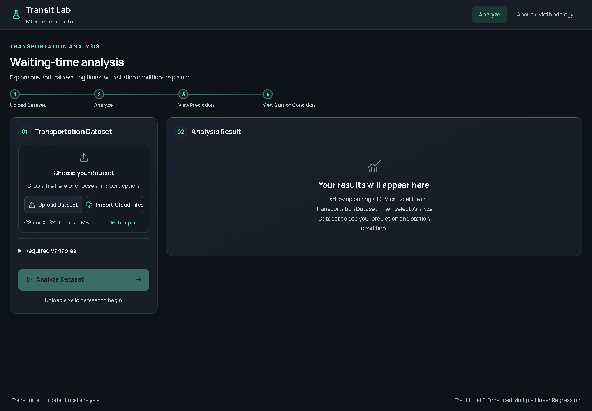

# Transit Research Lab

A locally hosted web application for **Enhancement of Multiple Linear Regression Applied to Train and Bus Wait-Time Prediction with Threshold-Based Station Classification**. React + Vite + TypeScript provide the browser interface; FastAPI runs the existing Python research engine. The desktop application has been removed. The command-line research workflow remains available.

**Status:** implemented for controlled thesis experiments. The supplied 40-row workbook declares simulated waiting times and repeated corridor-level context values. It is a prototype dataset, not final thesis evidence; no real-world accuracy claim is made. First use opens with an empty analysis page; later visits restore the last dataset used in this browser.

## Deploy an online demo
https://mlr-sigma.vercel.app/ (system webapp)

The web interface can be hosted on Vercel with its Python API on Render. The deployed demo is public and does not require a login. Everyone can access the same workspace and data, so do not upload confidential, identifying, or sensitive research data.

1. In Render, create a **Blueprint** from this repository. The `render.yaml` service runs on Render's free instance and allows writes from the configured Vercel production domain.
2. In Vercel, connect the same GitHub repository, set **Root Directory** to `frontend`, and deploy with the detected Vite settings (`npm run build`, output `dist`). `frontend/vercel.json` proxies `/api` requests to the Render service.
3. Open the Vercel deployment.

The free Render instance can sleep when idle and uses temporary storage. Experiments, uploaded datasets, and results may be deleted when the instance sleeps, restarts, or is redeployed. Use this only for a temporary demonstration; persistent thesis work requires a paid backend with persistent storage and a backup plan. The API is public, and all visitors share the same data.

## Start on this computer

Double-click **`Start MLR System.bat`**. Your browser opens **http://127.0.0.1:8000**. Keep the server window open while using the app; press Ctrl+C in that window to stop it. The local Python environment, frontend dependencies, and compiled web interface are already installed on this computer.

Or, in PowerShell from this folder:

```powershell
& '.\.venv\Scripts\python.exe' main.py
```

On another Windows computer, install Python 3.12 or later, then run `powershell -ExecutionPolicy Bypass -File .\setup.ps1`. Node.js 22.12 or later is needed to rebuild the frontend; the source ZIP also includes compiled `frontend/dist` assets, so Python alone can serve that included build. Setup downloads dependencies; ordinary use works offline. `requirements-lock.txt` and `frontend/package-lock.json` record tested dependencies.

For a trusted local-network demonstration, run `main.py web --host 0.0.0.0 --no-browser` and visit `http://<server-LAN-address>:8000` from another device. Windows may require a private-network firewall rule. This local thesis implementation has no login or user separation; do not expose it to the public internet. The default launcher binds only to this computer.



The interface opens in dark mode with charcoal surfaces and mint accents. Tables, forms, dialogs, and chart previews use the same palette; downloaded figures retain light backgrounds for thesis reports. After updating an already running installation, stop the server with Ctrl+C, reopen the launcher, and refresh the browser with Ctrl+F5.

Navigation contains **Analyze** and **About / Methodology**. The main Analyze page keeps dataset input on the left and results on the right, stacking them on smaller screens. Advanced settings, classification explanations, and research details expand when needed. The dark theme and bundled local font work offline.

During analysis, the bus automatically moves across its scene with rotating wheels and a moving road. The animation has no play/pause control and continues regardless of the device's reduced-motion preference. Results still appear as soon as analysis finishes, with no artificial delay.

## Dataset library and cloud import

Select **Import Cloud Files** beside Upload Dataset to open **Cloud: Transportation Datasets** directly. The list includes two 180-row Bus/Train demos and the earlier 500-, 200- and 40-row workbooks. Select a demo/prototype to load it through normal validation, then select **Analyze Dataset**. These workbooks are software examples, not final research evidence. Their original source declarations, units and limitations are preserved; the 40-row prototype still cannot produce a valid final station condition. Selecting a workbook creates a new experiment and preserves previous experiments; it does not bypass research confirmations or train automatically.

Every dataset card now imports directly into Transit Lab when clicked. No browser download or manual re-upload is required. Successful validation closes the picker and updates Transportation Dataset; select Analyze Dataset when ready. The list also includes MRT-3 daily ridership and historical Metro Manila transit schedules, marked **Incomplete for analysis**. These lack measured waiting times and matching predictors, so attempts to import them show the actual missing-column error and preserve the current dataset. Their source information remains in `docs/PHILIPPINE_DATA_SOURCES.md`. All bundled files are available locally.

The dialog follows the reference application's direct file-list flow: search, select, load. It has no provider tabs, account connection, or sharing-link form. To use your own file, download it from your storage account if necessary and select **Upload Dataset**. The existing shared-link backend endpoint remains for compatibility, but is not part of this interface.

Files retain the 25 MB limit and required-column validation. Failed imports preserve the previous dataset.

Explicit units in a workbook's **Sources_Methodology** sheet (Variable and Unit columns) now fill in automatically on import. Ambiguous or absent units remain editable in Classification definitions. The revised study presets use **vehicles/hour** and **km**, after values are checked or converted. See [measurement amendments](docs/MEASUREMENT_AMENDMENT.md) and the [Philippine data review](docs/PHILIPPINE_DATA_SOURCES.md).

## Using the analysis tool

**Import Dataset > Analyze > View Result**

For mode-specific evaluation, provide a **Transport Mode** column containing **Bus** or **Train**. For a single-mode file without this column, use **Set transport mode** beside the dataset, save, and analyze again. Missing labels stay unspecified. The system reports pooled metrics and additional bus/train metrics on the matching subsets of the same test predictions; it still fits one pooled model.

1. Choose or drop a CSV/XLSX dataset. Templates are available beside the upload control. Validation shows the file name, observation count, **7/7 required variables detected**, and three preview rows. **View Full Dataset** opens the searchable dataset.
2. Click **Analyze Dataset**. An unapproved interaction specification requires an explicit researcher confirmation once. **View configured interaction terms** reveals that specification; **Advanced Settings** allows editing it. Existing approvals are reused when valid.
3. If unusual observations require review, the app opens **Review unusual observations**. Retain, exclude, or correct a row with a reason. Retain is the default; **Continue Analysis** records the shared reason for remaining retained observations and preserves existing corrections/exclusions. No observation is automatically deleted. Previously recorded decisions can be reopened from **Advanced Settings**.
4. **Analysis Result** shows the enhanced **Predicted Waiting Time**, the selected observation's **Station Condition**, and **Model Accuracy** as Enhanced MLR RMSE in minutes. The primary panel does not show research tables or factor calculations. RMSE is overall test-set prediction error, not a confidence percentage.
5. Open **View Details** to inspect actual and predicted values, the Traditional/Enhanced MLR comparison, MSE/RMSE, errors, IQR information, interactions, coefficients, and charts. **View Predictions** on the main result opens the table for the active All / Bus / Train filter; selecting a row updates the main prediction and condition. **View Threshold Details** inside this dialog reveals the seven-factor explanation, training-only quartiles, score calculation, and classification bands.
6. Undefined classifications remain **Requires Researcher Decision**. View Details identifies missing definitions or insufficient variation. Provide justified rules/units through **Advanced Settings**, or import appropriate varied recorded data for constant factors, then analyze again. The interface never invents a classification to fill the summary.
7. **Export Results** remains beside View Details and offers the Excel workbook, CSV tables, and complete reproducibility ZIP. The dark palette, compact typography, navigation, and backend methodology are preserved.

After both models finish, **View Details > Predict new observations** accepts a separate CSV/XLSX with all six predictors and no Actual Waiting Time. It uses the fitted models and provides downloadable predictions, without changing evaluation metrics or retraining. A `Station ID` or `Station` column also enables descriptive station summaries: mean score over classifiable rows plus unresolved counts.

The first two configured interactions are thesis examples and require explicit approval. Settings changes clear the current results; rerun the analysis afterward. Already reviewed flags and an approved specification are reused when still valid. Changing the split or IQR screening can reset review decisions. Source data remains unchanged, and the held-out observations are not corrected or excluded through the review interface.

Each upload is saved separately under `.web-data/`. The last selected dataset is restored across browser refreshes and server restarts. Previous research files remain on disk; the simplified interface has no experiment-management or history page. Export results before replacing a dataset when you want an easily accessible copy. Conflicting writes from another tab are rejected. Stop the server before backing up `.web-data/`.

The UI calls the additive model **Traditional MLR**. Existing research files use **Baseline MLR**, and their **Pending configuration** label corresponds to **Requires Researcher Decision**. Old saved exports remain intact; rerun older analyses to include the newly added selected-interaction table in their workbook/CSV bundle.

The [revision review](docs/SIMPLIFICATION_REVIEW.md) records the original pages, merged components, preserved logic, thesis comparison, and unresolved methodology. The baseline-review design and classification rules not explicitly specified in the PDF require researcher/adviser review before making corresponding thesis claims.

## Dataset contract

| Exact column | Type | Meaning |
| --- | --- | --- |
| Traffic Condition | Category | Observed traffic category; consistent spelling |
| Weather Condition | Category | Observed weather category |
| Passenger Volume | Nonnegative number | Number of passengers in a defined observation window |
| Route Distance | Nonnegative number | Distance in a consistent unit, documented in config |
| Vehicle Frequency | Nonnegative number | Observed service frequency in vehicles/hour under the revised collection definition; verify and declare the actual input unit |
| Time of Day | Category | Defined observation period |
| Actual Waiting Time | Nonnegative number | Observed waiting time in **minutes** |

Do not enter headway in minutes as Vehicle Frequency: these are different measurements. The original thesis Table 3.1 says "number of available vehicles," while the selected system protocol uses observed service frequency in vehicles/hour. This amendment must be reconciled with the adviser-approved thesis. The application does not infer or convert units; verify and declare them for each dataset. Automatic severity direction follows the reviewed-training relationship; configured directions are preserved.

Missing/invalid required data is rejected with an explanation. The program does not impute or create observations. At least 10 rows are required to create a usable split; this is a software minimum, not a justified thesis sample size. Substantially more observations are needed to estimate multiple coefficients reliably.

Optional metadata such as `Record ID`, `Station ID` (or `Station`), or `Transport Mode` is preserved, **never used as extra predictors**. Station identifiers enable a mean-score summary over classifiable held-out observations; unresolved rows are counted, not assigned scores. This is a descriptive summary for the test period, not a real-time or independently validated station condition. Supplied Record IDs must be unique and nonempty. If absent, the app generates row-position IDs. Keep the source file and its row order unchanged when reusing review decisions. Bus/train metrics are subsets of the same pooled model, not separate mode-specific fits.

## Configuring the experiment

Research defaults are in `src/config.py`. The web forms save per-experiment snapshots without editing those defaults:

- Test fraction and random seed: 0.20 and 42.
- IQR multiplier: 1.5. Default checks cover Passenger Volume, Route Distance, Vehicle Frequency, and Actual Waiting Time. Remove the target from `IQR_COLUMNS` if your approved protocol limits screening to predictors.
- Initial interaction specification: Passenger Volume × Vehicle Frequency; Passenger Volume × Vehicle Frequency × Time of Day. These come from the supplied examples and require your research justification. Only explicitly named terms are constructed. Higher-order terms do not automatically add every lower-order interaction.
- Category dictionaries are explicit overrides. Without an override, each category mean Actual Waiting Time is compared with reviewed-training Actual Waiting Time Q1/Q2/Q3 to generate a score. The learned mapping, mean, thresholds, source, and status are saved separately from configuration. Unseen test categories remain unresolved unless explicitly configured.
- New numerical directions default to `None` (automatic). The sign of reviewed-training Pearson correlation with Actual Waiting Time determines higher/lower severity. A zero or unavailable relationship remains unresolved; explicit configured directions take precedence. A negative Vehicle Frequency relationship produces reverse scoring. Existing saved directions are preserved, not silently replaced.
- Vehicle Frequency unit starts empty and must be defined before final station labels are issued.
- Include optional `Station ID` (or `Station`) metadata for station-level summaries. The generated transportation template includes `Station ID`.
- Waiting-time thresholds and combined-score thresholds are explicit and configurable.

For a frozen or shared run, `main.py run` accepts an exported `config.json` via `--config`. That snapshot overrides the Python defaults for that run; it does not modify `config.py`.

## Methodology details

See [Classification rules and prototype audit](docs/CLASSIFICATION_RULES.md) for the current training-derived rules, variation safeguards, and saved-result compatibility. After updating the backend, restart the server and select **Analyze Dataset** to update an older saved classification. Old exported bundles remain historical artifacts.

Both model specifications use scikit-learn `LinearRegression`, with an intercept and ordinary least squares. The main B/C comparison uses reviewed data; the extra A baseline uses original training records. Both use **the same reviewed training observations** and are evaluated against the same untouched test observations. IQR fences are learned from the original training partition; encoding and classification quartiles are learned from the reviewed training partition. Test values never set the fences, category ordering, or numerical thresholds.

Categorical predictors use training-only reference-category dummy encoding. The alphabetically first observed training category is the reference. Category ordering for encoding is unrelated to severity. For a selected interaction involving a category, each of its non-reference indicator columns is multiplied with the other selected predictor columns. Two categorical factors produce the Cartesian product of their respective contrast blocks. A constant category has no estimable contrast. Every estimable main-effect column is retained.

Categories seen only at test time get zero contrasts and an explicit `Unseen Categories` flag. This is a reference-category fallback, not a learned estimate for that new category. Review this limitation before interpreting those predictions. Missing severity mappings leave classification pending. No test category means are used to resolve it.

Quartiles use pandas linear interpolation. For increasing severity, scores are 0, 1, 2, 3 at `x <= Q1`, `Q1 < x <= Q2`, `Q2 < x <= Q3`, and `x > Q3`. Reverse scoring is `3 - score`. Partially tied quartiles can leave some severity bins empty. If all three quartiles collapse or the variable is constant/effectively constant, its score is missing and its status is **Insufficient Variation for Classification**, even if a direction is configured. No average over fewer than seven factors is produced.

Predicted waiting-time scores are:

| Wait used for classification | Severity |
| --- | --- |
| 0 through 15 minutes | 0 |
| More than 15 through 20 | 1 |
| More than 20 through 25 | 2 |
| More than 25 | 3 |

The notes overlap the endpoints; these intervals explicitly assign each boundary once. A negative OLS prediction is flagged. Its raw value is retained for errors/MSE/RMSE; a separate zero-floored value is used only for station classification. Error is **actual minus predicted**.

The six predictor scores and enhanced waiting-time score are summed and divided by seven. Scores `[0,.75)`, `[.75,1.5)`, `[1.5,2.25)`, and `[2.25,3]` correspond to Normal Operation, Minor Delay, Moderate Delay, and Severe Delay. These are researcher-defined decision-support rules, not validated operational standards or an independently trained classifier. A missing component never becomes a fabricated Normal label.

MSE improvement is baseline minus enhanced; negative improvement means the enhanced model is worse. Percentage improvement is undefined when the baseline error is zero. Rank, residual degrees of freedom, and conditioning are reported; they are diagnostics, not hypothesis tests. Coefficients express conditional model associations, not causal effects. Interaction figures show one term's fitted contribution over observed training interaction values, not the full predicted wait.

The fixed random split implements the supplied notes. Correlated observations from the same vehicle, journey, station, or adjacent times can make random-split accuracy optimistic. Choose the observation unit and sampling design before claiming generalization. Changing to a grouped/time split would be a separately documented methodological change. Repeatedly selecting interactions using held-out performance also compromises the test set: fix the specification before evaluating a final test split.

The main comparison is B vs C and isolates interaction specification. Each new complete run additionally fits an original-data Traditional baseline (A). A vs B examines recorded corrections/exclusions; A vs C examines the combined workflow. All three use the same untouched test rows. No changed training records means no demonstrated review benefit. This is a descriptive single-holdout comparison, not a causal or significance claim.

See [THESIS_PROTOCOL.md](docs/THESIS_PROTOCOL.md) for exact methods and manuscript amendments, and [DATA_COLLECTION_GUIDE.md](docs/DATA_COLLECTION_GUIDE.md) for observation-level requirements. Record source information and research rationales in **Advanced Settings > Research documentation**. The additional comparisons appear in **View Details > Model Performance > Separate data review and interaction effects**. Old saved runs remain available; rerun Analyze Dataset to produce the new protocol outputs.

## Command-line usage

```powershell
# Empty templates
& '.\.venv\Scripts\python.exe' main.py template

# Training-only inspection before modeling
& '.\.venv\Scripts\python.exe' main.py inspect 'data\recorded.csv'

# Experiment using config.py
& '.\.venv\Scripts\python.exe' main.py run 'data\recorded.csv'

# Reproduce an explicitly configured experiment
& '.\.venv\Scripts\python.exe' main.py run 'data\recorded.xlsx' --config 'path\config.json' --reviews 'path\review_decisions.json'

# Verification
& '.\.venv\Scripts\python.exe' -m pytest -q
```

Download review decisions from **Export Results ? Other formats & reproducibility files**, or edit the `decisions` dictionary in the review bundle produced by `inspect`. Keep its identifying hashes intact. The dictionary is keyed by flagged training `Record ID`. Each entry contains `action` (`retain`, `exclude`, or `correct`), a nonempty `reason`, and, for corrections, a `corrections` object mapping exact column names to verified values. The CLI rejects a bundle from a different source file, training split, or IQR screening and validates that every referenced record is flagged and belongs to training.

## Export contents

Completed web analysis runs are stored under `.web-data/<experiment-id>/runs/<run-id>/`; CLI runs use `outputs/`. Each complete run contains:

- `experiment.xlsx` and `csv/`: predictions, individual factor scores, labels, metrics, differences, coefficients, interaction coefficients, selected interaction specifications, IQR flags/fences, review audit, training-only category evidence, severity quartiles, encoding references, model diagnostics, exact split membership, original/reviewed training rows, original test rows, and warnings.
- `figures/`: actual/predicted plots for both models, MSE and RMSE comparisons, classification distribution (including pending labels), IQR counts, and selected interaction contributions.
- `config.json`: research parameters and explicit overrides.
- `classification_rules.json`: learned category mappings, applied numerical directions, training waiting-time quartiles, methodology version, and numerical tolerances. The workbook and CSV evidence tables include means, sources, statuses, and assigned scores.
- `review_decisions.json`: reusable decisions bound to the source-file hash and training/IQR fingerprint.
- `manifest.json`: source-file hash, config hash, source-module hashes, environment versions, row counts, warnings, and comparison conclusion.
- `models.joblib`: fitted OLS models, encoding rules, classifier thresholds, and run metadata. Only load your own trusted Python model artifacts.
- `SUMMARY.md`: observed comparison and limitations.
- Web runs additionally include `web_experiment.json` (revision, dataset name, interaction approval, configuration/review history) and `experiment-bundle.zip`.

Spreadsheet formula prefixes in text fields are escaped in CSV/Excel; numerical predictions remain numeric. Unique raw observations and source files are preserved. Keep the source-code version alongside the bundle: hashes establish identity but are not a copy of the code.

## Project layout

```text
main.py                       Web server / CLI entry point
Start MLR System.bat          Windows launcher
setup.ps1                     Installation helper
requirements*.txt            Dependencies and tested versions
data/                         Empty collection templates
outputs/                      Unique experiment bundles
models/                       Optional researcher-managed model storage
src/config.py                 Explicit research parameters
src/data_loader.py            Validation and fixed split
src/irregularity_detection.py  Training IQR and review audit
src/interaction_terms.py       Encoding and selected interactions
src/mlr_model.py               Baseline/enhanced OLS
src/evaluation.py              MSE, RMSE, and comparisons
src/station_classification.py  Seven-factor severity scoring
src/experiment.py              Shared workflow
src/export.py                 Reports and reproducibility
src/visualization.py           Matplotlib PNG figures
backend/app/main.py           FastAPI startup and compiled frontend serving
backend/app/api/routes.py     Thin HTTP routes
backend/app/schemas/          Validated input contracts
backend/app/services/         Local experiment storage and orchestration
frontend/src/                 Analyze/About pages, research components, API client
frontend/dist/                Compiled offline browser assets
frontend/tests/browser.mjs    Browser workflow and responsive layout checks
.web-data/                    Local source uploads, revisions, saved experiments
tests/                        Artificial software fixtures only
docs/                         Plan, references, and methodology notes
```

## Development and verification

Start the API in one terminal: `.\.venv\Scripts\python.exe main.py web --no-browser`. In a second terminal, run `cd frontend` then `npm.cmd run dev`. Open the Vite address printed in that terminal; it proxies `/api` to port 8000. Rebuild with `npm.cmd run build` before using the ordinary launcher again.

Run Python checks with `.\.venv\Scripts\python.exe -m pytest -q`. Run `npm.cmd run test:e2e` in `frontend/` after building for the browser workflow test. It uses temporary, explicitly artificial fixtures and an isolated server on port 8766; Edge/Chrome is detected on Windows. Elsewhere, set `PLAYWRIGHT_BROWSER_PATH` or install Playwright Chromium. Test data never enters your research workspace.

The original thesis specifies Python research tools but does not require a web or desktop interface. Document React/Vite/TypeScript and FastAPI in Sections 3.2.2 and 3.3.2 as implementation choices from your web brief. The research contributions remain IQR review, selected OLS interactions, and multi-factor threshold classification.

See `docs/SIMPLIFICATION_REVIEW.md` for the current architecture and thesis comparison, `docs/VALIDATION.md` for test evidence, and `docs/REFERENCES.md` for verified research and GitHub references. No third-party project code or dataset was copied into this implementation.


New research exports include `study_metrics`, `study_comparisons`, `study_predictions`, original-data coefficients/checks, source notes, and research documentation. The complete bundle adds `research_protocol.json`, `data_provenance.json`, and the original-data model in `models.joblib`. The original main metrics, charts, and predictions remain B/C for compatibility; the A/B/C tables explicitly identify each experiment. Source declarations are not independent verification.
