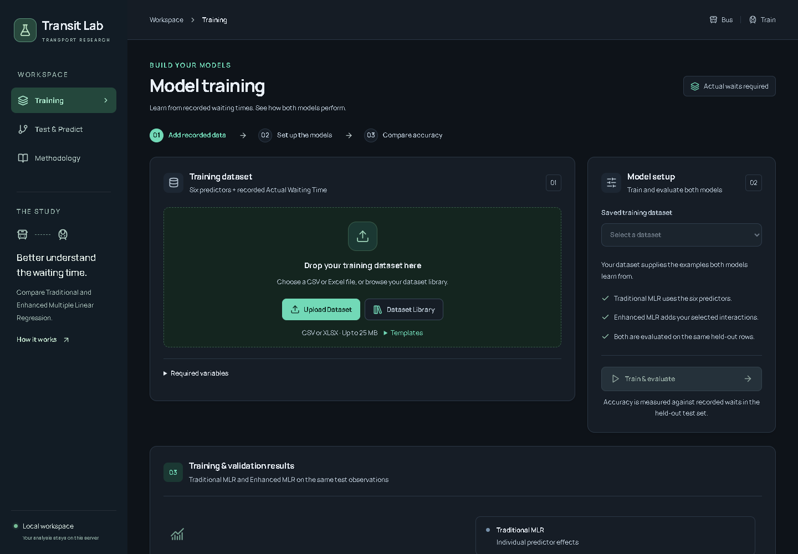

# Transit Research Lab

Existing React / TypeScript frontend, FastAPI backend, and Python OLS research pipeline for train and bus waiting-time prediction. Current input schema: **station-calendar-v2**.

The exact six predictors are **Passenger Volume, Vehicle Frequency, Station / Stop, Time of Day, Day of Week, and Month of Year**. Actual Waiting Time is the supervised target, never a predictor. Bus and Train models are trained separately.

**Status:** software supports validated preview, supervised training with observed waits, and inference with compatible fitted models. The revised categorical station-severity methodology is pending documented approval by default. Current six-predictor candidate files do not contain measured passenger waits; no model performance is claimed for them.

Read [Six-predictor implementation and methodology](docs/SIX_PREDICTOR_MIGRATION.md) for the schema, preprocessing, SOPs, source limitations, approval decisions, and local file checks.

## Deploy an online demo
https://mlr-sigma.vercel.app/ (system webapp)

The web interface can be hosted on Vercel with its Python API on Render. The deployed demo is public and does not require a login. Everyone can access the same workspace and data, so do not upload confidential, identifying, or sensitive research data.

1. In Render, create a **Blueprint** from this repository. The `render.yaml` service runs on Render's free instance and allows writes from the configured Vercel production domain.
2. In Vercel, connect the same GitHub repository, set **Root Directory** to `frontend`, and deploy with the detected Vite settings (`npm run build`, output `dist`). `frontend/vercel.json` proxies `/api` requests to the Render service.
3. Open the Vercel deployment.

The free Render instance can sleep when idle and uses temporary storage. Experiments, uploaded datasets, and results may be deleted when the instance sleeps, restarts, or is redeployed. Use this only for a temporary demonstration; persistent thesis work requires a paid backend with persistent storage and a backup plan. The API is public, and all visitors share the same data.

## Start on this computer

Double-click **`Start MLR System.bat`**. Your browser opens **http://127.0.0.1:8000**. Keep the server window open while using the app; press Ctrl+C in that window to stop it. The local Python environment, frontend dependencies, and compiled web interface are already installed on this computer.

Or, in PowerShell from this folder:

```powershell
& '.\.venv\Scripts\python.exe' main.py
```

On another Windows computer, install Python 3.12 or later, then run `powershell -ExecutionPolicy Bypass -File .\setup.ps1`. Node.js 22.12 or later is needed to rebuild the frontend; the source ZIP also includes compiled `frontend/dist` assets, so Python alone can serve that included build. Setup downloads dependencies; ordinary use works offline. `requirements-lock.txt` and `frontend/package-lock.json` record tested dependencies.

For a trusted local-network demonstration, run `main.py web --host 0.0.0.0 --no-browser` and visit `http://<server-LAN-address>:8000` from another device. Windows may require a private-network firewall rule. This local thesis implementation has no login or user separation; do not expose it to the public internet. The default launcher binds only to this computer.



The interface uses a dark workspace with teal accents and a navigation sidebar, readable tables, and separate training and prediction pages. After a frontend rebuild, refresh the browser with Ctrl+F5. Reopen the launcher if the backend also changed.

Navigation contains **Training**, **Test & Predict**, and **Methodology**. Training (`#/training`) has recorded-data input, model settings, held-out validation results, and the three SOP sections. Test & Predict (`#/predict`) has a separate upload and trained-model selector; it accepts blank or omitted Actual Waiting Time. Results use the full content width, and the layout stacks on small screens. Page switching preserves the separate uploads and prediction results in memory; refresh restores the saved training run, but prediction files must be uploaded again. The bundled font works offline. The old `#/analyze` link opens Training.

During analysis, the bus automatically moves across its scene with rotating wheels and a moving road. The animation has no play/pause control and continues regardless of the device's reduced-motion preference. Results still appear as soon as analysis finishes, with no artificial delay.

## Import and analysis

1. Use **Upload Dataset** for CSV or XLSX (up to 25 MB). Templates contain the six predictors plus optional metadata and the target column. The historical frequency column name is accepted as an import alias and normalized to Vehicle Frequency. Calendar categories use names; station identifiers are text.
2. Preview is available even if Actual Waiting Time is blank or omitted. Repeated predictor rows are preserved. No training experiment or accuracy is created for these files.
3. For labeled data, set Bus or Train, then open **Model settings > Research documentation**. Document the source/observation definition and confirm genuine recorded targets and counts available at prediction time. Counts covering future portions of an hour must not be used.
4. Review **Edit interaction terms** and **Split & IQR settings**. The default is one candidate pairwise interaction. Confirm the specification before running. Higher-order terms are never selected automatically, and hierarchy is retained.
5. **Train & evaluate** fits the original additive model A, reviewed additive model B, and reviewed interaction model C on the same held-out observations. Review flags with source-supported retain/correct/exclude decisions. No flags are removed automatically.
6. **View Details**, **View Predictions**, **Research Figures**, and **Export Results** expose the existing results and diagnostics. MSE, RMSE, MAE, and R2 require held-out actual waits. No improvement is presumed.
7. **Three SOP solutions** provides live links to IQR evidence (A/B), interaction evidence (B/C), and the seven-factor classification explanation.

For predictor-only files, open **Test & Predict**, choose a completed compatible model under **Saved training run**, confirm input availability, and select **Generate predictions**. A blank-target file uploaded on Training is passed to this page without replacing the saved training dataset. A labeled file uploaded on Test & Predict is directed to Training instead of silently fitting another model. Traditional and Enhanced predictions appear separately. Actual Waiting Time stays blank in the downloaded CSV. New predictions do not modify fitted models or their evaluation metrics. Unseen stations/categories are rejected during inference. Old-schema models are incompatible and preserved on disk, never silently reused.

## Station classification

The seven factors remain the six predictors plus Enhanced MLR predicted wait. The four output levels remain Normal Operation, Minor Delay, Moderate Delay, and Severe Delay.

Station and calendar categories have **no automatically inferred severity**. In **Classification definitions**, proposed category mappings remain inactive until a rationale is recorded and the revised classification is explicitly approved. Missing mappings and insufficient numerical variation keep the overall score pending. Regression predictions work independently. See [Classification rules](docs/CLASSIFICATION_RULES.md) and the [full proposal](docs/SIX_PREDICTOR_MIGRATION.md#sop-3-proposed-revised-framework-approval-pending-by-default).

## Dataset library and source records

Old bundled workbooks use superseded predictors and simulated targets, so they are no longer selectable. Original files and provenance records are retained. No new synthetic research dataset is bundled. The local Dataset Library now lists audited NYC Train packages and an AC Transit Bus source-review subset produced by the updated collector. Train packages contain all six predictors; Bus frequency remains unverified and blank. Both lack measured waiting-time targets. See [the collected data import guide](docs/COLLECTED_DATA_IMPORT.md) for files, source definitions, row counts, and regeneration commands.

Source limitations remain visible: NYC service counts are at station-complex level; AC Transit APC can cover only equipped buses; SUNT presence counts are not distinct arrivals. Schema validation does not establish that their measurement definitions match the intended prediction task. Full details and the results of checking the user's local exports are in the [migration record](docs/SIX_PREDICTOR_MIGRATION.md#source-and-timing-limitations).

Record IDs and metadata are retained. XLSX Source_Audit sheets require an explicit matching unique key or exported CSV row number. The importer does not merge unrelated datasets by row order or similar predictor values.

## Research artifacts and reproducibility

Each training upload is saved under `.web-data/`; settings/review changes create revisions and invalidate previous current results. Original files and older result bundles remain. The application restores the last compatible experiment after refresh. Concurrent stale revisions are rejected.

Exports include the dataset split, original/reviewed training rows, review audit, reference encoding, interactions, coefficients/diagnostics, A/B/C comparisons, source declarations, classification approval/mappings, schema version, model artifacts, figures, and run-specific METHODOLOGY.md. [Thesis protocol](docs/THESIS_PROTOCOL.md) explains interpretation.

The [older illustrated SOP PDF](docs/sop-guide/System_SOP_1_to_3_Illustrated_Guide.pdf), [Word guide](docs/sop-guide/System_SOP_1_to_3_Illustrated_Guide.docx), and chapter guides are **historical old-schema artifacts**. Their screenshots and artificial values have not been relabeled as current data or findings. Use the current methodology record for this revision.

## Verification

```powershell
.\.venv\Scripts\python.exe -m pytest -q
npm.cmd --prefix frontend run build
npm.cmd --prefix frontend run test:e2e
```

Browser tests use temporary isolated storage and explicitly artificial records. Screenshots go to `frontend/test-results/schema-v2/`. Tests do not establish research accuracy. See [validation log](docs/VALIDATION.md).

CLI: `main.py template` writes empty templates; `main.py inspect dataset.csv` also validates predictor-only files without training. For `main.py run`, supply a current configuration declaring the single mode, recorded targets, and input availability. The field-collection helper preserves completed-window counts and derives calendar labels from recorded passenger timestamps; it never estimates waits from frequency.
