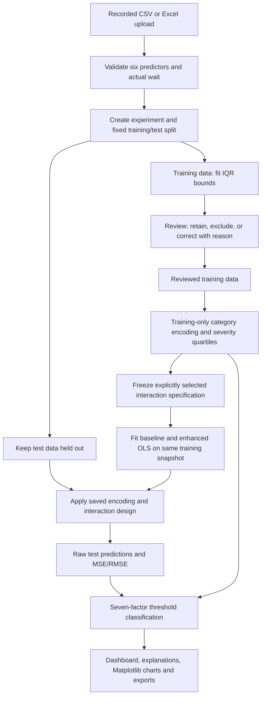

> Historical implementation plan. The current two-page interface and methodology review are documented in [SIMPLIFICATION_REVIEW.md](SIMPLIFICATION_REVIEW.md). Earlier page/navigation descriptions below are superseded.

# Local web application: thesis alignment and implementation plan

Status: implemented after the user's instruction to remove the desktop app and convert it to web. All nine pages use React/Vite/TypeScript with a local FastAPI backend and the shared Python research core. The desktop module and its test have been removed. See [VALIDATION.md](VALIDATION.md) for verification and [../README.md](../README.md) for startup instructions.

## 1. Thesis-to-system alignment

The original thesis does not prescribe a web interface or a desktop GUI. Section 3.3.2, Table 3.3 (printed page 40; PDF page 45), lists Windows, Python, Jupyter, Pandas, NumPy, scikit-learn, Matplotlib, OpenPyXL, and Excel. React, Vite, TypeScript, FastAPI, and the local deployment arrangement are new implementation choices from the web brief. Add these to the software requirements and explain the presentation/API layers in Section 3.2.2. The research contributions remain IQR screening, selected interaction terms in OLS MLR, and multi-factor threshold classification.

All page references below are PDF viewer page numbers for `Raymart (2).pdf`, not printed chapter page numbers.

| Web module | Thesis basis | Required behavior |
| --- | --- | --- |
| Dashboard | Section 3.2.2, pp. 42–43; Chapter 4 summary, p. 53 | Summarize the selected recorded experiment; no live operational claims |
| Dataset | Section 3.1 and Step 1, pp. 34–37 | Exact six predictors and actual wait; validate and split before learned processing |
| Irregularity Detection | Step 2, p. 37; Section 3.4.2, p. 48 | Training-only IQR fences; explicit retain, exclude, or correct decisions with reasons |
| Interaction Terms | Step 3, p. 38 | Preserve main effects; explicitly selected pairwise and higher-order terms; consistent feature design |
| Model Training | Step 4, pp. 38–39 | Additive and interaction-enhanced MLR, both ordinary least squares |
| Model Evaluation | Step 6, p. 40; Section 3.4.2, p. 49 | MSE/RMSE on the same held-out observations; evidence-based comparison |
| Prediction Results | Step 5, pp. 39–40; Step 8, p. 42 | Original predictors, actual wait, both raw predictions, and errors |
| Station Classification | Step 7, pp. 40–41; Chapter 4.3, pp. 52–53 | Explain all seven factors and the combined classification for each observation |
| Results Export | Step 8, p. 42; Chapter 4, pp. 51–53 | Download traceable results, coefficients, screening/review records, and figures |

### Rules that require clarification or explicit documentation

1. **Detailed scoring rules:** the PDF describes predefined thresholds but does not fully establish the quartile scoring, equal weights, and numerical bands supplied in the earlier notes. Preserve those explicit implementation rules and document them as researcher-defined; do not attribute their operational validity to the PDF or library documentation.
2. **Frequency measurement:** the thesis variable table calls Vehicle Frequency the number of available vehicles. Define whether this means vehicles per time window or an available-vehicle count. Reverse scoring assumes more vehicles is favorable; headway in minutes is a different meaning.
3. **Unspecified research decisions:** category severity mappings, Route Distance direction, measurement units, and the final interaction specification need explicit researcher decisions. Initial example interactions will appear as suggestions requiring an Apply specification action; they will not silently count as approved selections.
4. **IQR contribution:** using identical reviewed training rows for both models isolates the interaction specification. It cannot independently establish IQR review's performance benefit in Chapter 4.1. A separate, documented before/after experiment would be needed for that claim; it will not be silently added to this implementation.
5. **Station identity and transport mode:** the six predictors do not identify a station or distinguish bus from train. Optional identifiers can be preserved as visible metadata excluded from both models. The interface must label the classification unit as an observation and must not invent station-wide aggregation. Separate recorded datasets/runs can support separate bus and train analyses.
6. **Boundaries and negative waits:** retain the existing explicit intervals [0,15], (15,20], (20,25], and >25. Raw negative predictions remain in metrics and are flagged; only the waiting-time classification value is floored at zero.
7. **Data availability:** no recorded dataset is currently available. Dashboard metrics and plots remain empty until a real experiment is run. Software test fixtures are separate from research data.

## 2. Web application architecture

- **Frontend:** React, Vite, TypeScript. One sidebar, nine page routes, a selected-experiment context, and reusable table/metric/form components. Use forms for research configuration and review decisions; no Python or JSON editing is required for routine use.
- **Backend:** FastAPI and Python. Pydantic request schemas, structured JSON responses with TypeScript client contracts, thin API routes, experiment orchestration services, and local artifact storage.
- **Research core:** reuse the tested modules currently in `src/`. API endpoints call services; services invoke the research modules. Regression equations and scoring rules are calculated only in Python.
- **Charts:** generate Matplotlib figures in the backend and display the PNG files in React. Charts and exports use the same stored experiment results.
- **Persistence:** local dataset directories and experiment bundles containing configuration snapshots, review decisions, split IDs, results, models, and provenance. A cloud database or external service is unnecessary for the initial thesis scope.
- **Development:** Vite serves the browser application and proxies `/api` requests to local FastAPI.
- **Thesis demonstration:** build the frontend and serve its assets through FastAPI, together with `/api`, from one localhost address such as `http://127.0.0.1:8000`. SPA page refreshes require an explicit frontend fallback that excludes `/api` routes. Local-network binding can be a separately configured local deployment mode; no cloud publishing is planned.
- **Runtime:** data processing and training run as local jobs; the frontend displays status and prevents conflicting edits to the active run. Results are associated with a dataset ID, experiment ID, and configuration revision, never an unqualified global last model.

Vite supports React/TypeScript scaffolding and static builds: [official Vite guide](https://vite.dev/guide/). FastAPI supports serving local static assets: [official FastAPI documentation](https://fastapi.tiangolo.com/tutorial/static-files/). Tested versions are recorded in `frontend/package-lock.json` and `requirements-lock.txt`.

## 3. Page structure

| Page | Main interface and actions |
| --- | --- |
| Dashboard | Dataset/run identity, record/split counts, unique IQR-flagged rows, both models' MSE/RMSE, recorded-observation classification counts, summary figures, and next available action |
| Dataset | CSV/XLSX upload, required-variable checklist, validation errors, measurement definitions, preview table with search/pagination, and explicit listing of metadata excluded from predictors |
| Irregularity Detection | Q1/Q3/IQR/fences, flagged numerical fields, source record values, retain/exclude/correct form, reason, and decision history |
| Interaction Terms | Six-predictor selectors, selected pairwise/higher-order lists, duplicate/self-interaction validation, approved specification summary, and Apply specification action |
| Model Training | Train baseline, train enhanced, and Train both controls; common run/split identity, status, main/interaction coefficients, intercepts, sample counts, and rank diagnostics |
| Model Evaluation | Both MSE/RMSE values, absolute/percentage differences, actual-versus-predicted plots, comparison charts, and outcome-dependent interpretation |
| Prediction Results | Original predictors and metadata, actual wait, both predictions, signed errors, negative/unseen-category flags, and download actions |
| Multi-Factor Station Classification | Training evidence and explicit mapping/direction/threshold forms; results table; selectable record with each original factor value, applicable threshold or mapping, assigned severity, equal-weight calculation, and final label |
| Results Export | Select CSV tables or full Excel workbook; download PNG figures and complete reproducibility bundle, including configuration and review records |

Use a quiet, academic design with readable tables and generous workspace. Loading, empty, validation-error, unreviewed, stale-result, and pending-configuration states must be distinct. A missing metric is shown as unavailable, not zero. Missing classification definitions never become a Normal label. The Dashboard represents a selected recorded experiment, not live station monitoring.

## 4. Backend and frontend module structure

The suggested backend structure is adapted to preserve the existing research core rather than duplicating its mathematical logic.

```text
MLR System/
  frontend/
    src/
      pages/                 # Nine research pages
      components/            # Tables, cards, charts, forms, severity breakdown
      services/api.ts        # Typed calls to the local API
      types/                 # Dataset, run, config, model and result types
      hooks/                 # Selected experiment and job status
      App.tsx
  backend/
    app/
      main.py                # FastAPI startup, routers, compiled frontend
      api/
        routes.py            # Upload, config, reviews, training, results, exports
      schemas/requests.py    # Validated write requests and revision checks
      services/
        experiments.py       # Local storage, revisions, background jobs, core calls
      config.py              # Server paths and runtime settings only
  src/                       # Existing shared, tested research modules
    config.py                # Research defaults and ResearchConfig
    data_loader.py
    irregularity_detection.py
    interaction_terms.py
    mlr_model.py
    evaluation.py
    station_classification.py
    visualization.py
    experiment.py
    export.py
  tests/                     # Research, CLI, API and persistence tests
    test_web.py              # API integration tests
  frontend/tests/browser.mjs # Browser workflow with temporary artificial data
  .web-data/                 # Runtime experiment directories (ignored)
  data/
  outputs/
  docs/
```

Backend configuration is for server operation; the existing ResearchConfig remains the single definition of research parameters. Web forms produce validated, explicit per-experiment config snapshots. Keep original datasets immutable and store corrections as reviewed training versions.

The engine supports baseline-only, enhanced-only, and both-model training. Independently fitted models combine only within one unchanged experiment revision. Enhanced training requires explicit interaction approval. Coefficients and metrics appear after individual training; complete prediction/classification tables and export bundles are generated once both models are available.

## 5. Data flow



Category means used to support severity decisions come only from reviewed training data. Waiting-time thresholds are fixed research parameters, not estimated from test predictions. If mappings/direction/unit definitions are missing, model evaluation can still complete while classification stays pending.

Each model and output records its source run and revision. A new source upload creates a new experiment. All configuration changes, including classification-only changes, conservatively invalidate current trained results and require retraining. Old run artifacts remain on disk with their own snapshots; current UI downloads refer only to the completed current revision. Changing the split/IQR fingerprint resets active review decisions while preserving history. One background worker serializes training/chart generation, and revision checks reject stale writes.

## 6. Implementation order

1. **Confirm contracts in documentation:** finalize the source-to-column mapping, run lifecycle, research config schema, and thesis-alignment notes. Keep unresolved research definitions explicit.
2. **Add the local API foundation:** health/status endpoints, dataset upload/validation, local artifact storage, experiment creation, and fixed split. Test using temporary software fixtures.
3. **Add IQR review and configuration services:** training evidence, all fences, audited decisions, selected interactions, and explicit severity configuration.
4. **Expose model training and evaluation:** preserve the existing combined workflow while adding individual controls tied to the same run snapshot; verify raw predictions, metrics, feature consistency, and leakage protection.
5. **Expose classification, charts, and exports:** return per-factor explanations and downloadable existing-format artifacts, including pending/negative/unseen-category behavior.
6. **Build the React interface in workflow order:** shell, Dataset, Irregularity Detection, Interaction Terms, Training, Evaluation, Predictions, Classification, Export; wire Dashboard to completed endpoints.
7. **Verify the whole local workflow:** existing research tests, API validation and revision tests, frontend type/build checks, browser interaction checks, and a complete upload-to-export test. No artificial experiment output becomes thesis evidence.
8. **Package the local launcher and update documentation:** one entry point for the browser application, offline runtime assets, installation instructions, and proposed revisions to thesis Sections 3.2.2 and 3.3.2.

The implementation order above is complete. The Windows launcher opens the browser on localhost port 8000. Runtime assets are local; no external API, cloud storage, GPS, IoT, or live transportation feed is required. No recorded research dataset has been supplied, so model performance and operational validity remain unevaluated.
