# Chapters 3–5, explained simply
## An illustrated guide to your MLR thesis

**Enhanced Multiple Linear Regression for Train and Bus Waiting-Time Prediction with Multi-Factor Threshold-Based Station Classification**

Prepared for Clarence • 20 November 2026

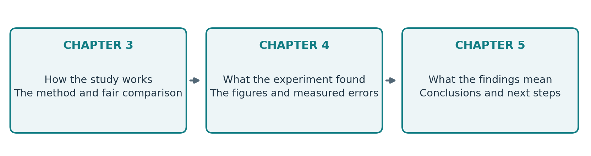

This guide explains your highlighted manuscript in everyday English. It keeps your **six predictors, waiting-time target, MLR model, and three proposed enhancements**. It is a study companion, with explanations you can practise saying aloud.

You will find the original system-architecture figure, the existing Chapter 4 charts, new teaching diagrams, worked calculations, and examples of careful Chapter 5 wording. Every chart discussion explains what to look at, what it means, and what it cannot establish.

**Three labels help you keep the material straight:**

- **Manuscript method:** a procedure or definition required by your highlighted thesis.
- **Teaching example:** small invented numbers used only to explain a calculation. These are not observations or thesis results.
- **Existing prototype result:** a real calculation by your software using the existing synthetic dataset. It explains the output, but it is not a measured result from Philippine passengers.

> **Your study in one sentence:** We compare ordinary MLR with a version that reviews unusual training records and models selected combinations of factors, then translate the prediction and six transportation factors into a station-condition score.

---PAGE---

# 02 / How to use this guide

Read the big idea first. Then learn the three comparisons. After that, the figures will be much easier to explain because you will know which question each figure answers.

| What you need to understand | Topics in this guide | What to remember |
|---|---|---|
| The method in Chapter 3 | 03–17 | Same test observations, six inputs, three comparison arms, seven classification scores. |
| The figures in Chapter 4 | 18–26 | Read the axes, compare the right arms, then explain the evidence. |
| Conclusions and recommendations in Chapter 5 | 27–30 | Each conclusion must follow from a result; each recommendation should address a limitation. |
| Speaking practice and terminology | 31–35 | Practise the short answers and check unfamiliar words in the glossary. |

## The three research questions

**Question 1: Does reviewing unusual records help?** The IQR step identifies records that deserve attention. Comparing Arm A with Arm B shows what changed after the documented review decisions.

**Question 2: Do selected interactions help prediction?** Comparing Arm B with Arm C tests whether adding combinations of predictors reduces error on the same test observations.

**Question 3: Can the numerical output be explained as a station condition?** The classification step combines seven severity scores. It provides an interpretable label under the study's rules. Agreement checks show how much prediction error changes that label.

## A quick reading route

If you have little time, read topics **04, 08, 11, 12, 15, 19, 25, 26, and 28**. Then practise the short presentation in topic 33. The numbers identify topics, so they remain useful even if your Word application changes pagination.

For every figure, ask: **What is being compared? What does each axis mean? Which direction is better? What actually happened? How far can I generalize the finding?**

> **Keep these two questions separate:** “Did the software perform the calculation?” and “Does the model predict real passenger waits accurately?” They require different evidence.

---PAGE---

# 03 / The whole system at a glance
Source: Highlighted manuscript, Section 3.2.2 and Figure 3.1, printed pages 47–48.

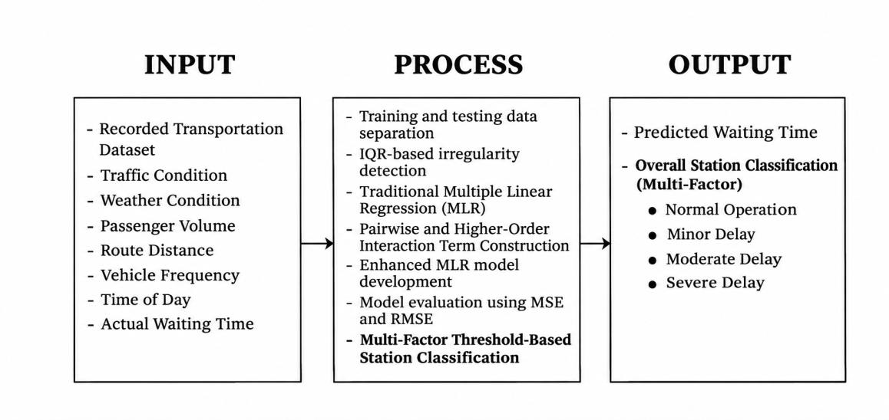

## Read the diagram from left to right

**Input means what the system receives.** During an experiment, each record contains the six transportation predictors and the actual waiting time. The actual wait is the known answer used to teach and evaluate the model. A future prediction uses the predictors; its actual wait is not yet known.

**Process means what the system does with the records.** It separates training from testing, reviews unusual training values, constructs selected interaction terms, fits the regression models, and compares predictions with the test answers. It then calculates the seven-factor station score.

**Output means what you obtain.** The system returns predicted waiting times, error measures, classification labels, factor scores, and records explaining how the run was performed. The highlighted text also includes **Requires Researcher Decision** when a classification cannot be resolved.

## What is actually being enhanced?

Your study retains MLR and Ordinary Least Squares. The enhancements concern **how unusual training records are reviewed, how selected combinations of predictors are represented, and how the numerical output is interpreted**. A website or dashboard is the way a person operates the system; it is not the mathematical enhancement itself.

> **Say it simply:** “We give the system transportation conditions. It estimates waiting time, checks how far its estimates are from the known answers, and summarizes the conditions using a seven-factor score.”

---PAGE---

# 04 / Research design and the three arms
Source: Sections 3.1 and 3.2.1, printed pages 31–32 and 43–44.

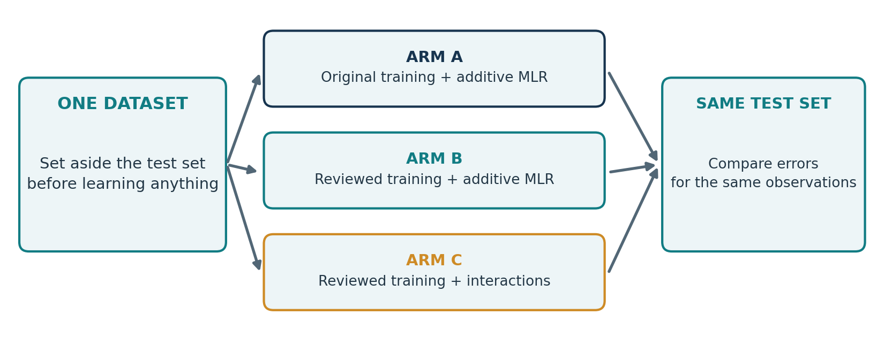

The study uses a **quantitative experimental design**: it measures numerical errors while changing specified parts of the modeling procedure. This does not mean you experimentally changed road traffic or assigned passengers to treatments. The controlled changes happen in the modeling workflow.

| Comparison | What stays the same? | What it tests |
|---|---|---|
| A versus B | Additive MLR and test observations | Effect of the recorded training-data review decisions. |
| B versus C | Reviewed training observations and test observations | Effect of adding the selected interaction terms. |
| A versus C | Test observations | Combined effect of the full enhanced workflow. |

Imagine checking three versions of an exam-solving method against the **same answer sheet**. Arm A studies the original practice material. Arm B studies the reviewed practice material. Arm C uses that same reviewed material with a more flexible way of combining clues.

If you compare A directly with C, two things may have changed: the training records and the model specification. That comparison alone cannot tell you which change mattered. Arm B provides the necessary middle comparison.

**If the review changes nothing, A and B should have the same training data and predictions under the same settings.** That is an informative outcome. It does not demonstrate an accuracy gain from correction or exclusion.

> **Say it simply:** “A versus B checks the review step. B versus C checks interactions. A versus C checks the combined workflow.”

---PAGE---

# 05 / Your six predictors and target
Source: Table 3.1 and Section 3.1.1, printed pages 33–35.

**A predictor is an input clue. The target is the answer you want to estimate.** Your target is a number of minutes, so this is a regression task. The later classification step converts the numerical and contextual information into labels.

| Variable | Plain-language meaning | What the highlighted definition requires |
|---|---|---|
| Traffic Condition | How congested the road is near the station | Observed condition at the passenger's arrival time, using fixed categories. |
| Weather Condition | What the weather is like at the station | Observed weather at that arrival time, using fixed categories. |
| Passenger Volume | How many people arrived for the service | Arrivals for the same service, stop, and direction in the preceding 60 minutes. |
| Route Distance | How long the service route is | Total route length in the observed direction, in kilometres. |
| Vehicle Frequency | How many serving vehicles arrived | Observed serving events for the same stop, route, and direction in the preceding 60 minutes; vehicles/hour. |
| Time of Day | Which predefined period contains the arrival | A category derived from the arrival timestamp using declared clock boundaries. |
| Actual Waiting Time | How long the sampled person actually waited | Minutes from arrival at the designated waiting area until boarding, including missed full vehicles. |

**Vehicle frequency is not the size of the fleet.** Twenty available buses does not tell you how many served this stop during the relevant hour. A timetable also does not establish the observed count.

**Route distance is not automatically the distance from the first station to the current station.** A station at the beginning of a route can have position zero while the complete service route still has a positive length.

**Six predictors do not mean six separate datasets are required.** They mean six types of information must describe each required observation. Existing records may be combined when their definitions and location/time coverage genuinely match.

> **Say it simply:** “Each row needs six clues about the passenger's situation and the waiting time that actually happened.”

---PAGE---

# 06 / What one valid observation means
Source: Section 3.1.1, printed pages 34–35.
Status: The times and counts on this page are teaching examples, not collected observations.

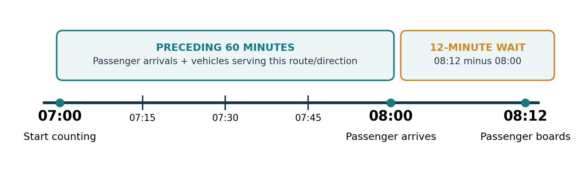

Suppose a passenger reaches the designated waiting area at **08:00** and boards the selected bus at **08:12**. The actual waiting time is **12 minutes**. If a full bus passes at 08:04 and the passenger cannot board it, that time remains part of the wait.

For this observation, passenger volume and frequency use the completed **07:00–08:00** window. For example, four consecutive 15-minute blocks might contain 80, 90, 110, and 120 passenger arrivals. Their total is **400 arrivals**. If two serving buses were counted in each block, the observed frequency is **8 vehicles/hour**.

The frequency formula is **60 × N / W**, where N is the count and W is the observation-window length in minutes. With N = 8 and W = 60, the result is 8 vehicles/hour. The manuscript fixes W at 60; it does not instruct you to replace a missing hour with a short count or scheduled interval.

Traffic and weather describe the station at **08:00**, the passenger's arrival time. Time of Day comes from the same timestamp. Route Distance comes from the selected route and direction.

## Why matching matters

A weather record from another year, a citywide average congestion profile, and a waiting-time average from another station do not establish this person's circumstances. Even if each source is genuine, the combined row may describe an event that was never recorded.

**Headway** is the time between vehicles. **Dwell time** is how long a vehicle stays at a stop. Neither automatically equals the passenger's arrival-to-boarding wait.

> **Say it simply:** “One row is one passenger-arrival situation. Every field must belong to that situation, with counts taken from the defined preceding hour.”

---PAGE---

# 07 / Training, testing, and leakage
Source: Sections 3.1 and 3.2.1, printed pages 32 and 36.

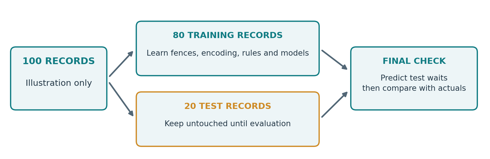

Think of the **training set as practice questions** and the **test set as the final exam**. The model uses training records to learn patterns. The held-out records assess how it performs on answers that were not used to fit it.

Your manuscript specifies an **80/20 holdout with random seed 42**, applied before screening, encoding, or learning thresholds. A seed is a repeatable instruction for the random process. It lets the same data and settings reproduce the split. It does not make the data representative or guarantee accuracy.

**Data leakage** happens when information from the test records helps construct the method being evaluated. For example, computing IQR fences from the whole dataset uses the test distribution before the final check. Choosing interaction terms because they look best on the test set also turns the test into practice material.

| Split type | Simple explanation | Why it matters |
|---|---|---|
| Random observations | Individual rows are assigned to training or testing. | The manuscript supports this when it suits the sampling design. |
| Grouped by station | Every record from a station stays in one partition. | Keeps repeated observations from the same station from appearing on both sides. |

An exact 80/20 row count may not be possible with grouped stations because groups have different sizes. Report the actual resulting sizes and grouping field.

The test partition remains unchanged during IQR review. It represents the observations you must predict, including valid difficult cases. Model construction uses only training information. When repeated cross-validation is used, each fold also needs its own fitted preprocessing rather than access to its validation answers.

> **Say it simply:** “We keep the exam separate from the practice material so the reported error is a fairer check.”

---PAGE---

# 08 / IQR: finding records to review
Source: Step 2 and Section 3.4.2, printed pages 37 and 55–56.

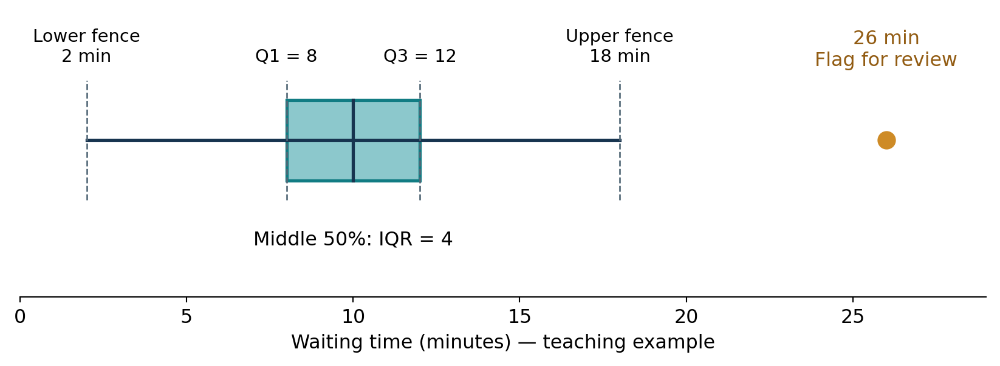

**Quartiles divide ordered values into four parts.** Q1 is the 25th percentile and Q3 is the 75th percentile. The IQR measures the width of the middle half of the values. It helps locate values unusually far from the central group.

Using the teaching values in the image:

- IQR = Q3 − Q1 = 12 − 8 = **4 minutes**.
- Lower fence = Q1 − 1.5 × IQR = 8 − 6 = **2 minutes**.
- Upper fence = Q3 + 1.5 × IQR = 12 + 6 = **18 minutes**.
- A 26-minute record lies above 18, so it is **flagged**.

The system screens **Passenger Volume, Route Distance, Vehicle Frequency, and Actual Waiting Time**, using training records only. It does not apply a numerical quartile rule directly to labels such as Rain or Peak Morning.

## Flagged does not mean wrong

A 26-minute wait may be a true service disruption. Retain it if the source supports it. A value of 260 may be a transcription error, but you need the original record to establish the correction. Exclusion also requires a documented reason; it is not justified merely because removal improves a metric.

For every flag, record **retain, correct, or exclude**, with the reason and supporting source. Preserve the original file and export the review history. This makes the review traceable.

**The IQR step does not promise better prediction.** Its effect is measured by A versus B. If no records change, the experiment has not demonstrated a benefit from correction or exclusion.

> **Say it simply:** “IQR tells us which records to inspect. The source evidence determines what we do with them.”

---PAGE---

# 09 / MLR and OLS without the jargon
Source: Step 4 and Section 3.4.1, printed pages 42–43 and 53–54.

**Multiple Linear Regression combines several clues into one numerical estimate.** It learns a coefficient, or weight, for each model column. The intercept is the starting value in the equation; the weighted contributions adjust that value.

> **Prediction = intercept + weighted main effects + any selected weighted interaction effects.**

In mathematical notation, the baseline is often written as **ŷ = β₀ + β₁X₁ + β₂X₂ + …**. The symbol ŷ means predicted waiting time. A coefficient β tells you how the fitted prediction changes with its associated column, while the other relevant terms are accounted for. The data-generating equation may include an error term ε; a prediction cannot include the unknown future error.

## What Ordinary Least Squares does

OLS searches for coefficients that minimize the **sum of squared residuals** in the training data. A residual is actual minus predicted waiting time. If the actual wait is 15 minutes and the prediction is 12, the residual is +3 and its square is 9. Squaring prevents positive and negative mistakes from cancelling and gives large mistakes more influence.

The formula β = (XᵀX)⁻¹Xᵀy in the manuscript expresses the mathematical solution when that inverse exists. You do not need to calculate the matrix by hand for the defense. Explain what it accomplishes: it finds the fitted weights that minimize squared training errors. Numerical software can use stable least-squares methods instead of explicitly forming the inverse.

## What “linear” means here

MLR is linear in its **coefficients**. It can contain a product such as Passenger Volume × Vehicle Frequency because that product is another model column with its own coefficient. The enhanced model still uses MLR and OLS.

A fitted association is not automatically a causal effect. For example, a positive coefficient for frequency does not by itself prove that adding vehicles causes longer waits. Frequency may coincide with crowded periods, and interpretation also depends on the other terms, data coverage, and model assumptions.

> **Say it simply:** “OLS learns the weights by making the squared mistakes on the training records as small as possible.”

---PAGE---

# 10 / Turning categories into model inputs
Source: Step 3 and Section 3.4.2, printed pages 40–41 and 56.

The model needs numerical columns, but traffic, weather, and time period are labels. Your method uses **reference-category indicator variables**. Each indicator answers a yes/no question with 1 or 0.

Suppose the observed training weather categories are Clear, Cloudy, and Rain. Clear is alphabetically first, so it is the reference in this teaching example.

| Weather | Cloudy indicator | Rain indicator |
|---|---|---|
| Clear | 0 | 0 |
| Cloudy | 1 | 0 |
| Rain | 0 | 1 |

Clear does not disappear from the data. It is represented when both indicators are zero. The fitted Cloudy and Rain coefficients describe differences relative to the reference, subject to the model's other terms. This avoids pretending that arbitrary category numbers such as 1, 2, and 3 have equal numerical distances.

## Why there can be more than six columns

The study has **six measured predictors**, but one predictor can expand into several indicator columns. Interactions add more columns. The inspected prototype run had 11 baseline feature columns and 21 enhanced feature columns, excluding the intercept. That does not mean the study secretly collected 21 independent transportation variables.

## What centering means

Before forming interaction products, the numerical factors are shifted by their training means. If passenger volume is 500 and the training mean is 400, its centered value is 100. If frequency is 8 and its training mean is 10, its centered value is −2. Their centered product is **−200**.

That product is a model input, not −200 minutes of waiting. Its fitted coefficient determines its contribution to the prediction. The manuscript retains the main effects in their original units and centers the numerical factors used in products. With all required lower-order terms present, this is a re-expression of the model, not a new set of predictions by itself.

> **Say it simply:** “Category indicators turn labels into yes/no columns. Centering measures the interacting numbers relative to the training averages.”

---PAGE---

# 11 / Pairwise and higher-order interactions
Source: Step 3 and Section 3.4.2, printed pages 40–41 and 56.

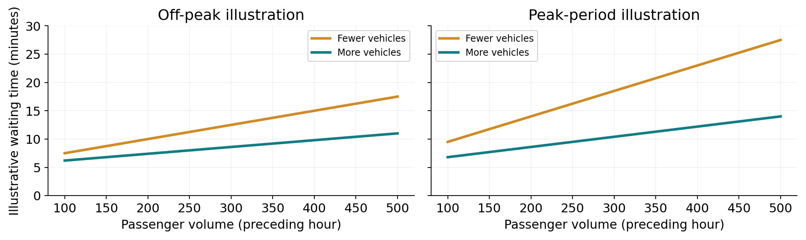

An **interaction** means the effect of one input depends on another input. Imagine 100 additional passengers arriving. The extra crowd may produce a different waiting-time change when many vehicles serve the station than when only a few do.

Your selected **pairwise interaction** is **Passenger Volume × Vehicle Frequency**. It allows the fitted relationship between volume and waiting time to change with frequency.

Your selected **higher-order interaction** is **Passenger Volume × Vehicle Frequency × Time of Day**. It allows that two-factor relationship to differ by time period. Because Time of Day is categorical, the system uses its non-reference indicator columns in the products.

## Why the smaller components stay in the model

The **hierarchy principle** retains the ingredients of a higher-order term. Along with the six original main effects, the model includes Passenger Volume × Vehicle Frequency, Passenger Volume × Time of Day, Vehicle Frequency × Time of Day, and the three-factor interaction. The two additional pairs support the specified three-factor term; they are not new measured variables.

This avoids making the meaning of the higher-order effect depend unnecessarily on an arbitrary zero point. The interaction structure is fixed before examining test performance, rather than trying every possible combination until one looks good on the test set.

More flexibility can model useful patterns, but it can also fit noise or make coefficients difficult to separate. **“Enhanced” describes the proposed specification; it does not guarantee a lower test error.** The B-versus-C comparison answers whether it helped in the experiment.

> **Say it simply:** “The model can learn that crowding matters differently depending on vehicle service and the time period.”

---PAGE---

# 12 / How to understand prediction errors
Source: Step 6 and Section 3.4.2, printed pages 43–44 and 57–58, 60–61.
Status: The three-row calculation below is a teaching example only.

| Record | Actual wait | Predicted wait | Actual − predicted | Squared error |
|---|---|---|---|---|
| 1 | 10 min | 12 min | −2 min | 4 min² |
| 2 | 20 min | 17 min | +3 min | 9 min² |
| 3 | 30 min | 31 min | −1 min | 1 min² |

**MSE: Mean Squared Error.** Add the squared errors and divide by the number of observations: (4 + 9 + 1) / 3 = **4.667 min²**. Lower is better. MSE gives relatively strong influence to large errors. Its units are squared minutes, so 4.667 is not an average wait or an average error in minutes.

**RMSE: Root Mean Squared Error.** Take the square root of MSE: √4.667 = **2.160 minutes**. Lower is better. It puts the squared-error measure back into minutes, making its scale easier to discuss. It does not mean every prediction is within 2.160 minutes of the answer.

**MAE: Mean Absolute Error.** Ignore the sign of each error and average the sizes: (2 + 3 + 1) / 3 = **2 minutes**. This is the average absolute prediction mistake for these records.

**R²: Coefficient of determination.** This compares squared prediction errors with the variation around the test-set mean. A score of 1 indicates perfect predictions on those records. A score of 0 matches that constant-mean benchmark, and a negative score is worse than it. R² = 0.84 is not “84% of passengers were predicted correctly.”

## Read the sign correctly

With residual = actual − predicted, a **positive residual means underprediction**: the person waited longer than the model said. A **negative residual means overprediction**.

Compare models on the same test observations and the same units. MSE and RMSE rank models in the same order on the same set because square root is increasing, but their numbers have different units. Do not combine them into one unlabeled quantity.

> **Say it simply:** “MSE and RMSE measure how far our predictions miss the answers. Smaller values mean smaller errors on this test set.”

---PAGE---

# 13 / Cross-validation and statistical checks
Source: Statistical Evaluation, printed pages 60–61.

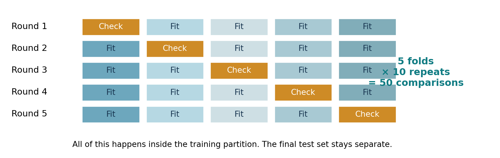

**Cross-validation is repeated practice testing inside the training data.** Divide the reviewed training records into five parts. Fit on four parts and check on the remaining part, rotating which part is checked. Repeat the arrangement ten times. The held-out final test set remains separate.

This shows how sensitive results are to different subdivisions of the available training records. The 50 scores are **not 50 independent new datasets**: the folds share records. Your manuscript therefore uses a corrected resampled t-test for the fold-level MSE differences to account for overlap in its uncertainty calculation.

## What the other checks tell you

- **Paired t-test:** compares paired squared errors from the two models on the same held-out observations, focusing on their mean difference.
- **Wilcoxon signed-rank test:** uses the signs and ranks of paired error differences. It offers a different check and still has assumptions.
- **Coefficient p-value and confidence interval:** describe uncertainty in a fitted coefficient under the analysis assumptions. A wide interval signals imprecision.
- **VIF:** checks how strongly one model column can be explained by the other columns. High VIF makes it harder to separate individual coefficient contributions.

A **p-value is not the probability that the model is correct**. It summarizes how compatible the observed comparison is with a stated no-difference hypothesis under the test assumptions. Your manuscript uses 0.05 as its significance level. A larger value does not prove equivalence; it means the procedure did not establish a difference at that level.

Statistical significance also does not establish practical usefulness, causality, or accuracy for a different population. Discuss the size of the error difference, the sample, and the data provenance along with the p-value.

> **Say it simply:** “We check whether the apparent improvement is consistent enough to distinguish from variation within this dataset.”

---PAGE---

# 14 / How classification rules are obtained
Source: Step 7 and Section 3.4.2, printed pages 45–46 and 58–59.

After Arm C predicts waiting time, the system assigns severity scores to **seven factors**: the six predictors and the predicted wait. A score can be 0, 1, 2, or 3. The rule for waiting time is fixed in the manuscript; rules for the transportation predictors are learned from the reviewed training data unless a documented configuration overrides them.

| Predicted waiting time used for classification | Severity score |
|---|---|
| 15 minutes or less | 0 |
| More than 15, up to 20 minutes | 1 |
| More than 20, up to 25 minutes | 2 |
| More than 25 minutes | 3 |

**Numerical predictors:** The system computes training quartiles Q1, Q2, and Q3. For increasing severity, values at or below Q1 receive 0, the next band 1, the next 2, and values above Q3 receive 3. If severity should decrease as the value increases, the order is reversed.

The direction comes from the sign of the relevant coefficient in an **additive regression using all six predictors on reviewed training data**. This accounts for the other recorded predictors when estimating the association. A documented researcher direction can override the derived direction.

**Categorical predictors:** The same additive regression estimates adjusted category differences. The most favourable category receives 0 and the least favourable 3; intermediate categories are placed proportionally and rounded to an integer. A documented mapping can override this.

For a factor that can be assessed but has **no statistically detectable adjusted effect** at the stated partial F-test threshold, the rule assigns zero severity. This does not prove that the factor has no real-world effect. It means this fitted analysis did not detect one.

Constant values, collapsed quartiles, or unresolved categories are a different issue. They can prevent a score from being assigned at all, as explained in topic 16.

> **Say it simply:** “The training data supply most of the scoring rules. Waiting time uses the fixed bands written in the thesis.”

---PAGE---

# 15 / Turning seven scores into one label
Source: Step 7 and Section 3.4.2, printed pages 45–46 and 58.
Status: The seven values below are an illustration, not a measured station result.

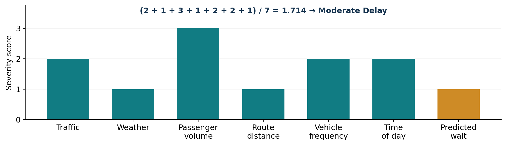

Every factor has the same weight: **one seventh**. Add the seven severity scores and divide by seven. Use the unrounded result when deciding the label.

| Multi-Factor Station Score | Overall condition |
|---|---|
| 0 to below 0.75 | Normal Operation |
| 0.75 to below 1.50 | Minor Delay |
| 1.50 to below 2.25 | Moderate Delay |
| 2.25 to 3.00 | Severe Delay |

In this example, suppose the predicted wait is **18 minutes**, giving a waiting-time severity of 1. The six other scores have already been obtained from the applicable rules. Their combination gives 12/7, so the **overall label is Moderate Delay** even though the waiting-time factor alone has a Minor score.

That is the reason for the term **multi-factor**. The overall label summarizes the combination of inputs and the predicted wait. It is not a renamed waiting-time band.

Equal weighting is a design choice, not proof that each factor has the same real-world importance. Predictor scores are also derived from relationships with waiting time, so the seven contributions should not be described as seven independent measurements of delay.

> **Say it simply:** “We score all seven factors, average them equally, and use the score boundaries to obtain the overall condition.”

---PAGE---

# 16 / Unresolved scores and unusual predictions
Source: Step 7 and Section 3.4.2, printed pages 46 and 59–60.

**Requires Researcher Decision is a meaningful outcome.** It means the available rules or information do not support a complete classification. The system must explain which factor or unit is unresolved.

| Situation | Why a label may be unresolved |
|---|---|
| A numerical factor is constant | The training sample contains no variation from which to establish meaningful severity bands. |
| Several quartiles collapse | The proposed four-band rule may not be distinguishable. |
| A new category appears in testing | No training-derived score or documented mapping may exist for it. |
| Frequency or distance units are undeclared | The system cannot safely interpret what the values measure. |
| A required factor has no resolvable rule | The seven-factor score is incomplete. |

The method does **not** average only the remaining factors, silently substitute zero for an unresolved factor, or label the record Normal by default. Unresolved records remain part of the reported total. For example, if 10 of 100 records are unresolved, a category count of 30 represents 30% of the full set, not 30/90 without explanation.

## Why an MLR prediction can be negative

Ordinary MLR does not automatically restrict predictions to positive numbers. A prediction of −1 minute is physically unsuitable as a waiting time. The manuscript retains the raw prediction when calculating errors so the evaluation reflects what the model produced. **Only the value entering the classification rule is floored at zero**, and the negative prediction is flagged.

## A station summary is a separate aggregation

If Station ID is available, the system groups the held-out records by station. It reports counts of classifiable and unresolved records, the mean score over the classifiable records, and the resulting label. It does not count every row as a different station.

This summary describes the analysed records and their period. It is not a live statement of today's station conditions, and the thresholds have not thereby been independently validated.

> **Say it simply:** “If the information cannot support all seven scores, the system says what is missing instead of inventing a complete label.”

---PAGE---

# 17 / Tools, hardware, and reproducibility
Source: Section 3.3, Tables 3.2–3.3, and Reproducibility, printed pages 48–53 and 60.

The requirements section explains the environment used to implement the method. The manuscript lists a Core i5 tenth-generation or Ryzen 5 class processor or higher, at least 8 GB RAM, 256 GB storage, integrated graphics, a 1920 × 1080 display, keyboard, mouse, and internet access for downloads. These are the manuscript's stated specifications, not a measured universal hardware threshold for every MLR problem.

| Tool or group | Plain-language job in this system |
|---|---|
| Python | Runs the research calculations. |
| Pandas and NumPy | Organize tables, compute numerical quantities, and form model inputs. |
| Scikit-learn and SciPy | Fit models, partition data, calculate errors, and perform statistical checks. |
| Matplotlib | Draw graphs so patterns and comparisons can be inspected. |
| Excel and OpenPyXL | Inspect, read, and export spreadsheet data. |
| FastAPI, Uvicorn, React, Vite, TypeScript | Connect the browser interface to the research engine. |
| pytest and Playwright | Check software behavior and interface workflows. |

The research question concerns the modeling method and its evaluation. A functioning browser interface helps someone run the procedure; interface correctness alone does not establish predictive accuracy.

## Reproducibility means another person can retrace the run

Keep the source-data identity, train/test membership, seed, review decisions, categorical references, centering means, selected interactions, units, model files, thresholds, metrics, and software versions. A source-code hash identifies the code version used. This is the experiment's audit trail.

For example, if two people obtain different RMSE values, the exported records can reveal that they used different rows, seeds, units, or review decisions. Without that information, it is difficult to know what the comparison means.

**Software verification and data validity answer different questions.** Passing tests can show that IQR flags, calculations, exports, and screen controls behave as intended. Only suitable observations and an appropriate evaluation design can support claims about real passenger predictions.

> **Say it simply:** “We save enough information to explain exactly how each result was produced and to repeat the calculation.”

---PAGE---

# 18 / Chapter 4: Figure 4.1 and IQR review
Source: Section 4.1, printed pages 62–63; existing Figure Guide and exported run dated 19 November 2026.
Status: Existing prototype result — synthetic data, 400 training records and 100 test records.

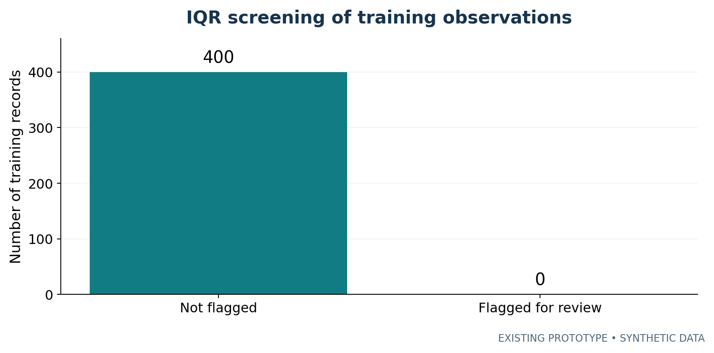

**Chapter 4 answers what happened when the procedure was run.** Your manuscript still has figure placeholders. The figures explained in topics 18–26 come from the separate Figure Guide and its existing prototype output; they are not newly obtained bus or train field results.

## How to read this graph

The horizontal axis separates **Not flagged** from **Flagged for review**. The vertical axis counts unique training observations. The first bar is 400 and the second is zero. That means the IQR rules did not flag any record in this run.

This chart establishes a screening count. It does not by itself show improved prediction. To assess the review's effect, compare the errors of A and B. Here both have MSE **9.6910** and RMSE **3.1130 minutes** because the training records were unchanged.

Do not describe zero flagged records as proof that the data are genuine, error-free, or representative. IQR tests an aspect of the numerical distribution; a synthetic dataset can also fall inside every fence.

> **Explain the figure aloud:** “All 400 training records remained within the IQR fences. No review changes were made, so Arms A and B produced identical errors. This run did not demonstrate a benefit from correction or exclusion.”

---PAGE---

# 19 / Figure 4.2a: the MSE comparison
Source: Section 4.2, printed pages 63–64; study_metrics.csv in the existing exported run.
Status: Existing prototype result — synthetic data, the same 100 held-out records for both models.

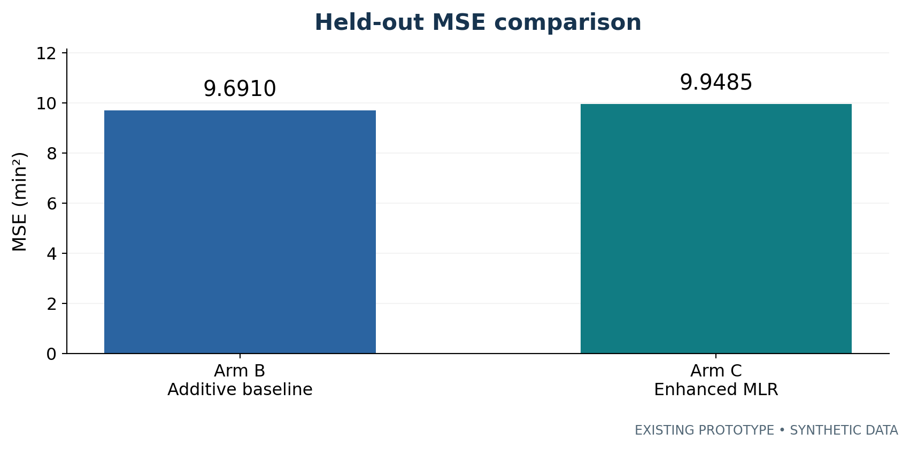

## Read the bars before explaining them

The horizontal axis names the models. The vertical axis shows **MSE in squared minutes**. A shorter bar means smaller average squared prediction error.

Arm B has MSE **9.6910**. Arm C has MSE **9.9485**. Therefore, the enhanced model has slightly higher error on these test records. The difference C − B is about **0.2575 min²**, approximately a **2.66% increase** relative to B.

If you report “MSE reduction” as B − C, the result is **−0.2575**. A negative reduction means the error increased. It should not be described as a positive improvement by dropping the minus sign.

This experiment added the selected interactions while keeping the reviewed training data and test observations the same. The result therefore provides the intended B-versus-C comparison. It does not mean interactions can never help; it means these selected terms did not reduce held-out error in this prototype run.

The error difference also needs its uncertainty checks. The existing paired tests did not establish a statistically significant B-versus-C difference at 0.05, as explained in topic 21.

> **Explain the figure aloud:** “Lower MSE is better. Arm C is slightly higher than Arm B, so this run does not show an improvement from the selected interaction terms.”

---PAGE---

# 20 / Figure 4.2b: error expressed in minutes
Source: Section 4.2 and study_metrics.csv in the existing exported run.
Status: Existing prototype result — synthetic data, 100 held-out records.

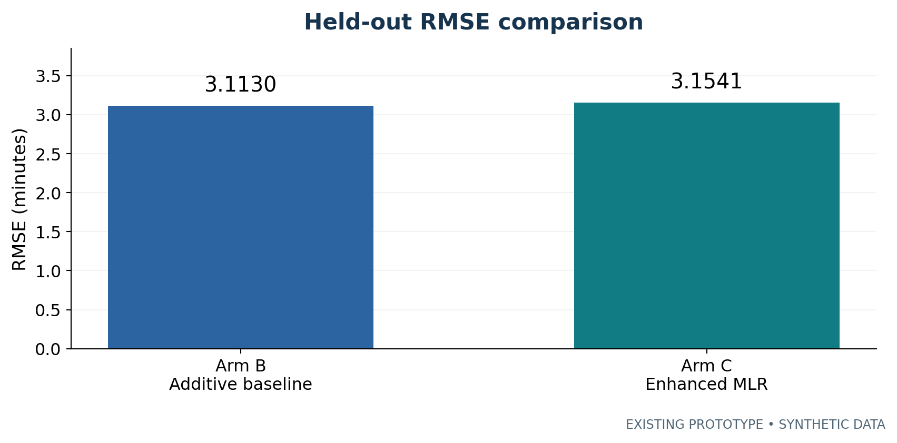

**RMSE is the square root of MSE.** The vertical axis is now minutes, which is easier to relate to passenger waiting time. The values describe prediction error, not predicted waiting duration.

Arm B has RMSE **3.1130 minutes**. Arm C has RMSE **3.1541 minutes**. The enhanced model's RMSE is approximately **0.0411 minute higher**, or about **2.5 seconds** higher on this error measure.

That 2.5-second difference is a difference between model-level RMSE values. It is not a statement that every passenger's prediction changes by 2.5 seconds. Individual errors can be much larger, smaller, positive, or negative.

## What you can and cannot say

You can say that the enhanced model had a slightly larger RMSE on the same prototype test set. You cannot turn RMSE into “the model is always within 3.15 minutes,” because RMSE is a summary and does not give a bound for every record.

MSE and RMSE tell a consistent story here: both favour the additive baseline slightly. They are related measures, not two independent experiments proving the same claim. The practical value of a particular error size would also require suitable real observations and an operational standard for acceptable error.

> **Explain the figure aloud:** “The error scale is about 3.11 minutes for the baseline and 3.15 for the enhanced model. The enhanced model did not reduce that error in this run.”

---PAGE---

# 21 / Figure 4.2c: repeated cross-validation
Source: cv_summary.csv, cv_significance.csv, and heldout_significance.csv in the existing run.
Status: Existing prototype result — 50 fold comparisons within the reviewed training partition.

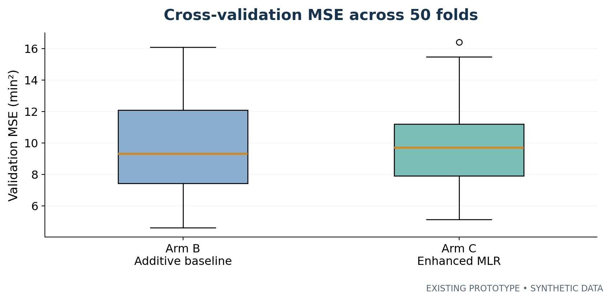

The vertical axis is fold-level MSE. The box shows the middle half of the scores, the line inside is the **median**, and the whiskers and any isolated points show more of the spread. The line is not the mean, so use the exported table when quoting average MSE.

The baseline mean MSE is **9.8422** and the enhanced mean is **9.9199**. The enhanced model has lower MSE in **42% of the 50 folds**, but its overall mean is slightly higher. It did not improve consistently across these subdivisions.

The corrected resampled t-test gives **p = 0.8569**. The held-out Wilcoxon test gives **p = 0.2653**, and the held-out paired t-test gives **p = 0.6428**. All exceed 0.05. These analyses do not establish a significant difference at that threshold; they do not prove the models are identical.

Do not use the apparent overlap of two boxes as a substitute for a statistical test. Likewise, the 50 fold values are not 50 independent real transport samples. They reuse the available training data.

> **Explain the figure aloud:** “The enhanced model's average cross-validation error was slightly higher. The corrected test did not establish a significant difference, so we do not claim a supported improvement.”

---PAGE---

# 22 / Figure 4.2d: actual versus predicted
Source: Existing actual_vs_enhanced.png and predictions.csv.
Status: Existing prototype result — the chart's “actual” values are synthetic dataset targets.

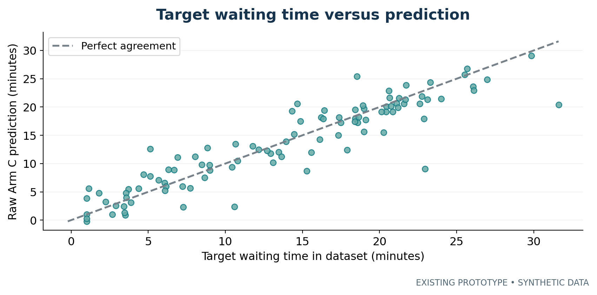

Each point represents one held-out record. The **horizontal position** is its target waiting time and the **vertical position** is the model's prediction. If both are 20 minutes, the point lies on the dashed line.

- A point **above** the diagonal is an overprediction: the model predicted a longer wait than the target.
- A point **below** the diagonal is an underprediction: the model predicted a shorter wait.
- A larger vertical gap from the line means a larger prediction error in minutes.

The broad upward pattern shows that the fitted predictions track much of the target variation in this prototype. However, several points are noticeably far from the line. A chart can look generally well aligned while still containing important large errors.

The run also flags a negative prediction. It remains visible and remains in the error calculation. A negative wait is not physically meaningful; the classification procedure handles it as described in topic 16.

The original export calls its target column **Actual Waiting Time**. That column name is not proof of field measurement. This redrawn chart labels it as the dataset target because the run's provenance explicitly identifies the values as synthetic/prototype.

> **Explain the figure aloud:** “Points near the diagonal are close predictions. Points far away show the cases the model misses. These points describe the prototype test records.”

---PAGE---

# 23 / A supporting residual plot
Source: Existing residuals_enhanced.png; optional diagnostic alongside Section 4.2.
Status: Existing prototype result — diagnostic image, not a new numbered manuscript finding.

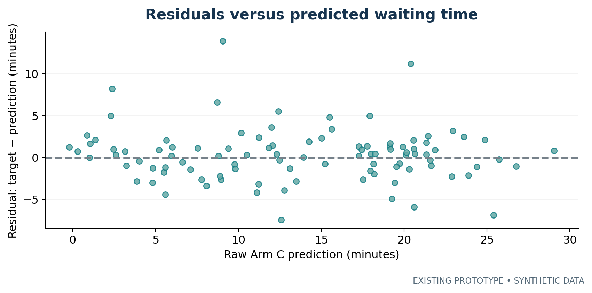

This graph isolates the mistakes. The horizontal axis is predicted waiting time. The vertical axis is the residual, **actual minus predicted**. The dashed zero line means a perfect prediction for that record.

Points **above zero** mean the target wait was longer than predicted. Points **below zero** mean the model predicted too much waiting. Notice that this sign interpretation is different from describing a point above the diagonal in the previous actual-versus-predicted plot: always read the axis definitions first.

A useful visual check asks whether residuals are scattered around zero or form a curve, a systematic offset, or a widening funnel. Such patterns can suggest an omitted relationship or changing error spread. They are clues for further examination, not complete proofs about all regression assumptions.

This plot shows a mixture of positive and negative residuals and several sizable misses. The presence of many points near zero does not make the larger misses disappear. MSE and RMSE are affected more strongly by those large errors than MAE is.

Do not delete held-out points because they look inconvenient in this graph. They are part of the evaluation. Any later model revision needs an appropriate new evaluation process rather than repeated adjustment to the same test answers.

> **Explain the figure aloud:** “This graph shows whether the model tends to predict too high or too low and whether the error pattern suggests something the model is missing.”

---PAGE---

# 24 / Figure 4.3a: condition counts
Source: Section 4.3, printed pages 64–65; existing station_classifications.png.
Status: Existing prototype result — labels for 100 held-out observations.

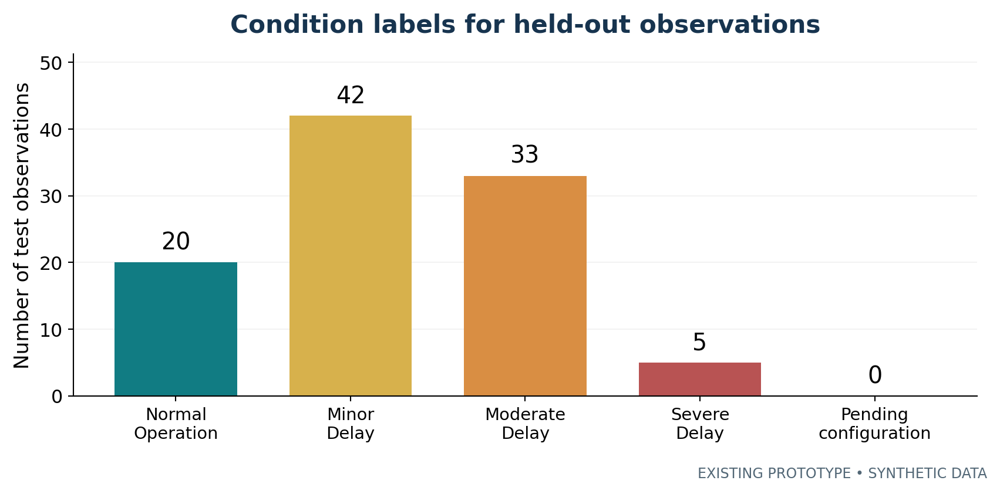

The vertical axis counts **observations**, not unique stations. There are 20 Normal, 42 Minor, 33 Moderate, and 5 Severe labels, with zero unresolved in this particular run. Because the total is 100, those counts also equal the percentages.

The most common label is Minor Delay. That means the seven-factor score fell into the Minor range for 42 of these prototype records. It does not establish that 42 real bus or train stations were experiencing minor delay.

This distribution explains how the rule categorizes the analysed records. It is not, by itself, a measure of accuracy. A classification rule could produce a plausible-looking distribution without agreeing with independently established operating conditions.

If a later run has unresolved observations, keep them in the total and report their reasons. Do not remove them merely to make the four-condition percentages look complete.

The station-level summary, when station identifiers exist, is a separate output. It groups records from the same station and reports the coverage and mean classifiable score; it should not be confused with this observation-count chart.

> **Explain the figure aloud:** “The chart shows how the 100 test records were distributed across the rule-based conditions. It describes the classified records, rather than the number of real stations.”

---PAGE---

# 25 / Figure 4.3b: agreement between labels
Source: classification_confusion.csv and classification_agreement.csv in the existing run.
Status: Existing prototype result — comparison of two labels produced by the same scoring framework.

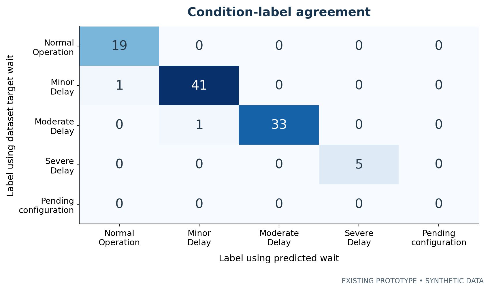

**Rows** show the condition obtained when the rule uses the target waiting time. **Columns** show the condition obtained when it uses the prediction. A diagonal cell means the two labels agree.

The diagonal adds to **19 + 41 + 33 + 5 = 98**, so exact agreement is **98/100 = 98%**. The two remaining observations move down by one condition level. Agreement within one level is **100%**, and Cohen's kappa is approximately **0.9702**.

This is agreement between two applications of the rule. It is **not 98% waiting-time accuracy**, nor independent confirmation that the labels match actual station operating standards. Six factors are identical in both applications, and broad score bands can hide differences in minutes.

The waiting-time factor alone agrees in **79%** of records. This helps explain how overall agreement can be 98% even when the waiting-time severity changes more frequently: changing one of seven components does not always cross an overall label boundary.

> **Explain the figure aloud:** “Replacing the target wait with the predicted wait changed the overall label for two of the 100 prototype records. This checks label stability under prediction error.”

---PAGE---

# 26 / Table 4.1: put the findings together
Source: Section 4.4, printed page 65; study_metrics.csv and model_diagnostics.csv.
Status: Existing prototype result — values below are copied from the saved run, not newly fitted results.

| Arm | Train | Test | MSE (min²) | RMSE (min) | MAE (min) | R² |
|---|---|---|---|---|---|---|
| A | 400 | 100 | 9.6910 | 3.1130 | 2.1602 | 0.8409 |
| B | 400 | 100 | 9.6910 | 3.1130 | 2.1602 | 0.8409 |
| C | 400 | 100 | 9.9485 | 3.1541 | 2.1936 | 0.8367 |

**A = additive MLR on original training data. B = additive MLR on reviewed training data. C = enhanced MLR on the same reviewed training data.** This editable table replaces the cramped table image in the older Figure Guide while preserving its values.

## Read the comparisons in order

**A versus B:** the rows and errors are identical. There were no flagged records and no training-data changes, so this run did not demonstrate a benefit from the review decisions.

**B versus C:** MSE, RMSE, and MAE are slightly higher for C, and R² is slightly lower. The interactions did not improve the measured prediction scores in this run. The paired tests and corrected cross-validation test did not establish a significant difference at 0.05.

**Classification:** the labels are computable and their overall agreement is 98% under the two wait inputs. That is a separate result from minute-level prediction error and needs its own interpretation.

## Do not overlook the diagnostics

The baseline has **11 feature columns** and the enhanced model has **21**. The maximum VIF rises from about **9.84 to 199.03**. The run warns about strong multicollinearity in the enhanced specification. This makes individual coefficient interpretations less precise; it does not by itself prove that every prediction is unusable.

There is also a warning about a negative prediction. These limitations belong beside the results, rather than being hidden because the summary scores look reasonable.

The run uses one random split of a 500-row synthetic dataset. Its export does not provide separate bus and train performance estimates. Do not describe the combined output as two independently verified transport-mode studies.

> **Say it simply:** “The prototype comparison shows no measured gain from these enhancements in this run, while the system still produces traceable predictions and rule-based labels.”

---PAGE---

# 27 / Chapter 5: connect evidence to conclusions
Source: Section 5.1, printed pages 66–67.

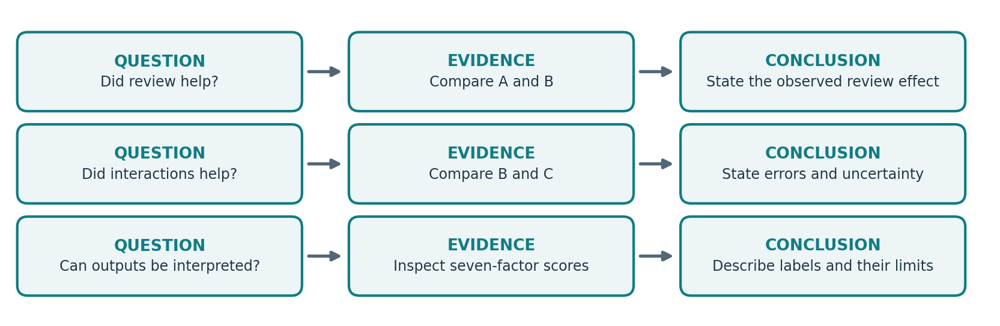

Chapter 5 explains the meaning of Chapter 4. It should not introduce a new dataset, a new model comparison, or an accuracy claim that the preceding results did not establish. Its job is to answer the research questions and explain what the findings justify.

## Conclusion 1: the irregularity-review step

Describe what the IQR screen found, how flagged cases were handled, and whether A-versus-B errors changed. A successful implementation of screening does not automatically mean screening improved prediction. In the inspected prototype, there were no flags or changes, so the supported conclusion is that no benefit from correction or exclusion was demonstrated in that run.

## Conclusion 2: the interaction specification

Explain which interactions were added and what B-versus-C error measures showed. If the enhanced model has lower error, describe the size of the reduction and its uncertainty. If its errors are similar or higher, report that outcome. A proposed enhancement is a hypothesis to evaluate, not a result that must win.

## Conclusion 3: the station-condition interpretation

Explain that the framework turns six predictor conditions and the predicted wait into an equal-weight score and condition label. Then explain the agreement check and the unresolved category. The existence of labels does not establish that the thresholds match independent operating standards.

**Scope belongs in the conclusion.** State which data, routes or stations, period, split, and transport modes were actually analysed. With the existing synthetic run, conclusions about calculations and prototype behavior must remain distinct from claims about recorded Philippine passenger performance.

> **Say it simply:** “Chapter 5 says what the evidence allows us to conclude, one research question at a time.”

---PAGE---

# 28 / Example conclusion wording you can understand
Source: Section 5.1 interpreted alongside the inspected prototype exports.
Status: The paragraphs below describe the existing prototype run only.

## A plain-language version

“The system implemented an MLR workflow with IQR screening and recorded review decisions, selected interactions, and a seven-factor station-condition score. Three comparison arms were evaluated against the same held-out records so that the review and interaction effects could be examined separately.”

“For the inspected 500-row synthetic prototype dataset, IQR screening flagged no training observations. The original and reviewed additive models therefore produced identical test errors. This run did not demonstrate an accuracy benefit from correction or exclusion.”

“Adding the selected interaction terms changed held-out MSE from 9.6910 to 9.9485 and RMSE from 3.1130 to 3.1541 minutes. The enhanced model had slightly higher error in this run. The paired tests and corrected repeated-cross-validation comparison did not establish a statistically significant difference at the 0.05 level.”

“The scoring framework generated condition labels for all 100 test records. Using predicted rather than target waits produced the same overall label in 98 cases. This measures agreement within the rule-based framework; it does not independently validate real station conditions.”

“These findings describe the implemented procedure and its behavior on the synthetic prototype. Real-world predictive accuracy requires aligned recorded observations meeting the manuscript's operational definitions.”

## Why these paragraphs work

They state the implemented contribution, answer the three research questions, include the actual direction of the metric changes, and identify the data on which those numbers were obtained. They do not convert a working system into an unmeasured real-world accuracy claim.

If a future suitable observed-data run produces different results, replace the numerical findings and conclusions with that run's evidence. Do not carry these prototype numbers into a paragraph describing real bus or train observations.

> **A short answer if asked whether the enhancement succeeded:** “The framework was implemented and evaluated. On this prototype, the selected interactions did not improve prediction. Improvement on real recorded transport observations has not been established by this run.”

---PAGE---

# 29 / Recommendations that follow from findings
Source: Section 5.2, printed pages 68–69.

A recommendation is stronger when you explain **which limitation it addresses and what the proposed action would test**. “Use a larger dataset” is incomplete by itself: a larger collection with the wrong target definition still does not answer the waiting-time question.

| Finding or limitation | Useful next action | Why it follows |
|---|---|---|
| Aligned recorded passenger waits are not present in the reviewed real-only files. | Obtain records with actual arrival-to-boarding waits and matching predictors. | Enables a real-world test of the fixed target and definitions. |
| One observed route or period may cover a narrow situation. | Evaluate suitable records across additional routes, stations, and periods. | Tests whether findings extend beyond the sampled setting. |
| One random holdout does not test future-period behavior. | Evaluate a time-based split using earlier records to predict later records. | Tests performance when operating conditions change over time. |
| Added interactions increased complexity without reducing prototype error. | Investigate justified specifications with an appropriate evaluation design. | Tests whether useful interactions can be identified without fitting test-set noise. |
| High VIF makes coefficients hard to distinguish. | Examine model-term dependence and report uncertainty. | Supports more careful interpretation of individual fitted effects. |
| Labels follow study-defined thresholds. | Compare labels with independently documented operational conditions. | Tests practical validity of the classification rules. |
| Unusual real delays may be valid events. | Continue source-based review and retain supported extremes. | Preserves the conditions the model may need to predict. |

Other algorithms and real-time feeds are possible **future research**, as the manuscript says. They are not changes required for explaining your present six-predictor MLR study. Similarly, the existing repeated cross-validation should not be described as something the current method never does; future work can extend it to broader observed samples and temporal evaluations.

> **Say it simply:** “Each recommendation addresses a specific limitation revealed by the experiment or the available data.”

---PAGE---

# 30 / Keep the evidence categories clear
Source: Highlighted data definitions; prototype provenance export; corrected workbooks reviewed in this conversation.

Your system can be finished while the dataset still lacks the observations needed for its final empirical evaluation. A useful explanation distinguishes the method, the software's calculations, the source figures, and the claims each one supports.

| Evidence available | What it can support | What is still missing |
|---|---|---|
| Implemented workflow and saved outputs | Explanation of the procedure, model comparisons, and software behavior. | An appropriate observed-data evaluation for real-world accuracy claims. |
| Existing 500-row synthetic prototype | Explanation of the displayed metrics and graphs for that run. | A basis for treating those targets as measured passenger waits. |
| Corrected bus workbook: 12 main-sheet rows | Published bus operational counts and supporting descriptive figures. | Traffic, weather, passenger volume, and actual waiting time in the main model sheet. |
| Corrected train workbook: 234 main-sheet rows | Source-matched hourly station-entry figures. | Traffic, weather, observed vehicle frequency, and actual waiting time in the main model sheet. |

The corrected workbooks leave unsupported fields blank, which is a useful correction. They currently have **zero complete rows for this fixed seven-column modeling requirement**. Their aggregate hourly rows also differ from the manuscript's sampled-passenger observation definition. The train's station-position distances differ from the required full service-route length.

A descriptive chart of hourly ridership is valid for discussing the ridership figures it contains. It does not become a waiting-time prediction evaluation unless matched waiting-time targets and the required inputs are available.

Use precise wording about availability: **“No suitable complete dataset has been obtained in the reviewed material.”** The searches and files do not prove that no such record exists anywhere. An FOI request title or an emailed response also does not supply the underlying observations to your workbook.

> **Say it simply:** “We can explain and inspect the existing calculations. The missing aligned observations limit what we can claim about real passenger prediction accuracy.”

---PAGE---

# 31 / Questions about your method

## Why use MLR?

The outcome is a continuous number of waiting minutes and the study examines several input variables together. MLR offers an interpretable baseline. Your research scope evaluates selected enhancements to that baseline, rather than searching across every prediction algorithm.

## What is the difference between baseline and enhanced MLR?

The baseline contains additive main effects. The enhanced model keeps those effects and adds the selected interaction terms and their hierarchy components. Both use OLS. The separate A/B/C design distinguishes the data-review step from the interaction specification.

## Why not delete every outlier?

A value far from the middle can be a real transportation event. Deleting all such values could erase severe congestion or service disruptions. IQR flags the record; source evidence supports the retain, correct, or exclude decision.

## Why split the data first?

The test records must not help define the rules used to predict them. Splitting first prevents test information from entering training-derived fences, encoding, centering, or thresholds. It also keeps the final evaluation set consistent across arms.

## Why do six predictors become more model columns?

Categorical predictors require several yes/no indicators, and interactions create products of columns. These are representations of the same six measured variables. They do not mean new independent observations or extra transportation measurements were collected.

## Why is a product term still linear regression?

The model remains linear in the coefficients being estimated. A product of inputs becomes another column with its own coefficient. The prediction can therefore describe conditional effects while the coefficients are still fitted by ordinary least squares.

## Does the study require several datasets or locations?

Six predictors do not require six datasets or six places. What matters is having enough suitable, aligned observations and variation to evaluate the specification. Coverage limits how far you can generalize. Constant factors can also create unresolved severity rules; simply adding unrelated locations or values does not solve that measurement problem.

> **Practice tip:** Answer the question in one sentence first. Then give one concrete example, such as a valid long wait or a passenger-volume effect that changes with vehicle frequency.

---PAGE---

# 32 / Questions about results and interpretation

## Did the enhanced model improve accuracy?

In the inspected synthetic prototype run, no. Its MSE and RMSE were slightly higher, and the reported significance checks did not establish a difference at 0.05. That describes this dataset and run; it does not establish performance on recorded Philippine passenger observations.

## Does R² around 0.84 mean 84% accuracy?

No. R² compares squared errors with the target variation around a constant-mean benchmark. It is not the percentage of passengers whose waiting time was guessed correctly. The unit-bearing error measures provide a different, useful view of the mistakes.

## Does 98% classification agreement mean 98% accurate station conditions?

No. It means two applications of the same scoring rule agree for 98 of 100 records when only the waiting-time input changes. An independent operational standard would be needed to establish accuracy of the condition labels themselves.

## Can headway replace waiting time?

Not under your highlighted target definition. Headway describes the spacing between vehicles; the target describes a sampled passenger's elapsed time until boarding. Their relationship depends on arrival patterns, capacity, missed vehicles, and other conditions. A convenient formula does not turn a missing wait into a recorded one.

## Is merging allowed?

Merging can be appropriate when the records refer to the required service, stop, direction, and time window and satisfy the operational definitions. Citing genuine sources alone does not establish that the combined fields describe the same observation.

## Why can a short predicted wait still produce Moderate Delay?

The overall label averages seven severity scores. A relatively low waiting-time score can coexist with higher scores for the other factors. Explain the per-factor scores rather than treating the overall label as a waiting-time-only threshold.

## What does “not statistically significant” mean?

The specified test did not establish a difference at the chosen threshold under its assumptions. It does not prove the models are equal, prove the null hypothesis true, or guarantee that a larger study would have the same result.

> **Practice tip:** A direct explanation of a limitation is stronger than changing the meaning of a metric to make the result sound better.

---PAGE---

# 33 / A short presentation you can practise
Status: This script describes the highlighted method and the existing synthetic prototype results. Adapt it only when you have different verified results.

## Chapter 3: what we did

“Our study predicts train and bus waiting time using six transportation variables: traffic, weather, passenger volume, route distance, vehicle frequency, and time of day. Actual waiting time is defined as the elapsed time from a sampled passenger's arrival at the waiting area until boarding.”

“We separate training and testing before learning the model or its rules. The IQR procedure flags unusual training records for documented review. We then compare three arms: additive MLR on original training data, additive MLR on reviewed training data, and enhanced MLR with selected interactions on the same reviewed data.”

“The selected interactions allow the effect of passenger volume to depend on vehicle frequency and the time period. All arms use OLS and the same test observations. We evaluate prediction errors and then calculate a seven-factor score for station-condition interpretation.”

## Chapter 4: what the inspected run showed

“The currently available figures describe a synthetic prototype run with 400 training and 100 test records. IQR screening flagged no records, so the original and reviewed baseline results were identical.”

“The baseline RMSE was about 3.113 minutes and the enhanced RMSE about 3.154 minutes. The selected interactions did not reduce error in this run. The significance checks did not establish a difference at the 0.05 level.”

“The classification labels agreed in 98 of 100 cases when the predicted wait replaced the dataset target wait. That checks stability of the scoring output under prediction error; it does not independently validate real station conditions.”

## Chapter 5: what follows

“The study provides an implemented and traceable comparison framework. The existing prototype does not demonstrate a prediction improvement from the selected interactions or a benefit from review changes. Establishing real-world accuracy requires aligned recorded observations meeting the manuscript's definitions, followed by an appropriate evaluation. Further work should also examine broader coverage, performance over time, and independent validation of the station-condition rules.”

**How to deliver it:** Pause after each chapter. When showing a graph, point to the axes and quote its values before stating the conclusion. Use “in this run” to keep the scope clear. Avoid memorizing a claim that the displayed evidence does not support.

---PAGE---

# 34 / A glossary in everyday language

| Term | Meaning for your study |
|---|---|
| Observation | One recorded case; your manuscript defines it as one sampled passenger arrival for a service, stop, and direction. |
| Predictor | An input clue used to estimate waiting time. |
| Target / dependent variable | The answer being estimated: actual waiting time in minutes. |
| Regression | Predicting a numerical value, such as minutes. |
| Coefficient | A fitted weight attached to a model column. |
| Intercept | The constant starting term in the fitted equation. |
| Residual | Actual minus predicted value; the signed prediction mistake. |
| OLS | The fitting method that minimizes summed squared training mistakes. |
| IQR | The distance between the first and third quartiles; the spread of the middle half. |
| Interaction | A relationship in which one predictor's effect depends on another. |
| Indicator / dummy column | A 1-or-0 column representing a category relative to a reference. |
| Holdout | Records kept separate for final evaluation. |
| Leakage | Test information improperly influencing the procedure used to predict those test records. |
| Cross-validation | Repeated fitting and checking on subdivisions of the available training records. |
| Overfitting | Learning details of the training sample that do not transfer well to other records. |
| MSE / RMSE / MAE | Different summaries of prediction mistakes; lower is better on the same evaluation set. |
| R² | A comparison with the variation around a constant-mean benchmark; not percent correct. |
| VIF / multicollinearity | A measure/problem concerning how much model columns overlap in their information. |
| p-value | A test-based check of how compatible the comparison is with a stated no-difference hypothesis, under assumptions. |
| Confidence interval | A range produced by a statistical procedure to express uncertainty in an estimate. |
| Threshold | A boundary used to assign a score or label. |
| Cohen's kappa | Label agreement adjusted for the agreement expected just from how often each label occurs. |
| Provenance | Where a dataset came from and how its values were obtained or transformed. |
| Reproducibility | Keeping enough data, code, and settings to retrace the analysis. |

---PAGE---

# 35 / Sources and figure map

## Documents used

**Primary manuscript:** Raymart - Revised (highlighted).docx and its PDF, in your Downloads folder. Chapter 3 begins on printed page 31, Chapter 4 on page 62, and Chapter 5 on page 66. Printed pages 33–35 define the dataset; pages 58–61 contain the detailed scoring and statistical procedures.

**Existing figure reference:** Chapter 4-5 Figure Guide.docx/.pdf and the Downloads folder named Chapter 4 Figures (VALIDATION). That guide identifies the displayed results as prototype results. The Chapter 4 graphs here are redrawn from the same saved numerical exports with larger labels for readability. Their values and prototype status are preserved; no models were refitted.

**Numerical verification:** Project folder outputs/20261119T145502_187046Z_a4706e. The inspected files include data_provenance.json, config.json, study_metrics.csv, study_comparisons.csv, iqr_flags.csv, cv_summary.csv, cv_significance.csv, heldout_significance.csv, classification_confusion.csv, classification_agreement.csv, and model_diagnostics.csv.

**Current data context:** bus_real_only_corrected.xlsx and train_real_only_corrected.xlsx, reviewed in this conversation. They are discussed to explain the present evidence limits, not used to create replacement waiting-time targets or new model results.

## Where each manuscript figure is explained

| Manuscript item | Guide topic | Image or table status |
|---|---|---|
| Figure 3.1: IPO architecture | 03 | Original figure from the highlighted manuscript. |
| Tables 3.1, 3.2, and 3.3 | 05–06 and 17 | Definitions and requirements explained in readable tables and prose. |
| Figure 4.1: IQR effect | 18 | Existing prototype screening graph, interpreted with the A/B metrics. |
| Figure 4.2: baseline versus enhanced | 19–23 | Existing MSE, RMSE, cross-validation, actual/predicted, and supporting residual plots. |
| Figure 4.3: classification | 24–25 | Existing condition counts and label-agreement matrix. |
| Table 4.1: summary | 26 | Editable table transcribed from the saved metrics. |
| Chapter 5 | 27–30 | Explanations and a new teaching diagram linking evidence to conclusions. |

New diagrams about the chapter sequence, comparison arms, observation timing, train/test split, IQR, interactions, cross-validation, seven-factor averaging, and conclusions are **teaching illustrations**. Their invented example values are explicitly labeled and are not added to any dataset.

This is a separate explanatory document. It does not replace the thesis, alter its six predictors, change the source workbooks, or supply missing observed waiting-time results.
